\thispagestyle{empty}
\newpage

# Introduction
## OED
**Optimal Experimental Design** (or OED for short) is a way for designing experiments that aims at maximising information gain while minimising a cost function. This cost function can encompass prediction uncertainty, material cost, deployment time... it is up to the user to select the parameters to optimise.

[The key concept is that **not all observations are equally informative**.]{.mark} 

This concept[^1] can be particularly interesting when working with participatory science datasets, as the cost for recruiting new participants can be pretty high, knowing which participants are the most likely to be the most informative is quite relevant.

The **BIODICAPT research project** fit exactly in this context. Voluntary participants will be recruited to expand the data collected in an ongoing (profesional) study but (due to time, logistical and budget constraint) will be able to select only a few participants among several hundreds. In this context, pre-studying the sampling designs (aka which participants/locations should be selected) can be very insightfull for data collection.

[^1]: Will sometimes be referred to as "adaptive sampling" in this report. Is also a concept close to "active learning" in AI models.

## The BIODICAPT project

The "BIODICAPT"  project is a French research project that aims at monitoring biodiversity of agricultural lands on a large (*i.e. national*) scale through the use of various recording devices.

### The BIODICAPT network
The "BIODICAPT network" is a network of approximately 125 agricultural lands that are already in partnership with some of the research institutes and laboratories participating in the BIODICAPT project.

Consequently, these fields are quite clustered around the laboratories that already periodically collect data in them. 

```{bash}
#| echo: false
f=../outputs/maps/biodicapt_sampling_locations_.pdf
dpi=300
# page size in pixels at the chosen dpi
read W H < <(pdfinfo "$f" | awk -v d=$dpi '/Page size/ {printf "%d %d", $3*d/72, $5*d/72}')

pdftoppm -png -r $dpi -singlefile \
  -x $(( W*30/100 )) -y $(( H*0/100 )) \
  -W $(( W*40/100 ))  -H $(( H*100/100 )) \
  "$f" ./images/biodicapt_sampling_locations_
```

{#fig-biodicapt width=75%}

The BIODICAPT project has an allocated budget to collect data outside of the agricultural lands that are already in partnership with research institutes and laboratories within the project. Data collected in addition to the BIODICAPT sites will enable to better represent the varying agricultural contexts in France metropolitan area. In order to do this, the project wants to make use of an already existing participatory science network, the 500 ENI network.

### The 500 ENI network
The "500 ENI network" is a long-term survey that was initiated by the French Ministry of Agriculture in 2012. Its aim is to monitor any changes of wild flora and wild fauna in agricultural landscapes, that could be associated with Non-Intended Effects (ENI) of agricultural practices, mainly the use of fertilisation and pesticides products.

It consists of approximately 500 fields distributed over all agricultural regions of mainland France (including Corsica), sampled yearly by voluntary observers. These field were originally chosen to be representative of the main crop productions of France's metropolitan area. Since then however, some farmers have switched crops.

```{bash}
#| echo: false
f=../outputs/maps/eni500_sampling_locations_.pdf
dpi=300
# page size in pixels at the chosen dpi
read W H < <(pdfinfo "$f" | awk -v d=$dpi '/Page size/ {printf "%d %d", $3*d/72, $5*d/72}')

pdftoppm -png -r $dpi -singlefile \
  -x $(( W*30/100 )) -y $(( H*0/100 )) \
  -W $(( W*40/100 ))  -H $(( H*100/100 )) \
  "$f" ./images/eni500_sampling_locations_
```

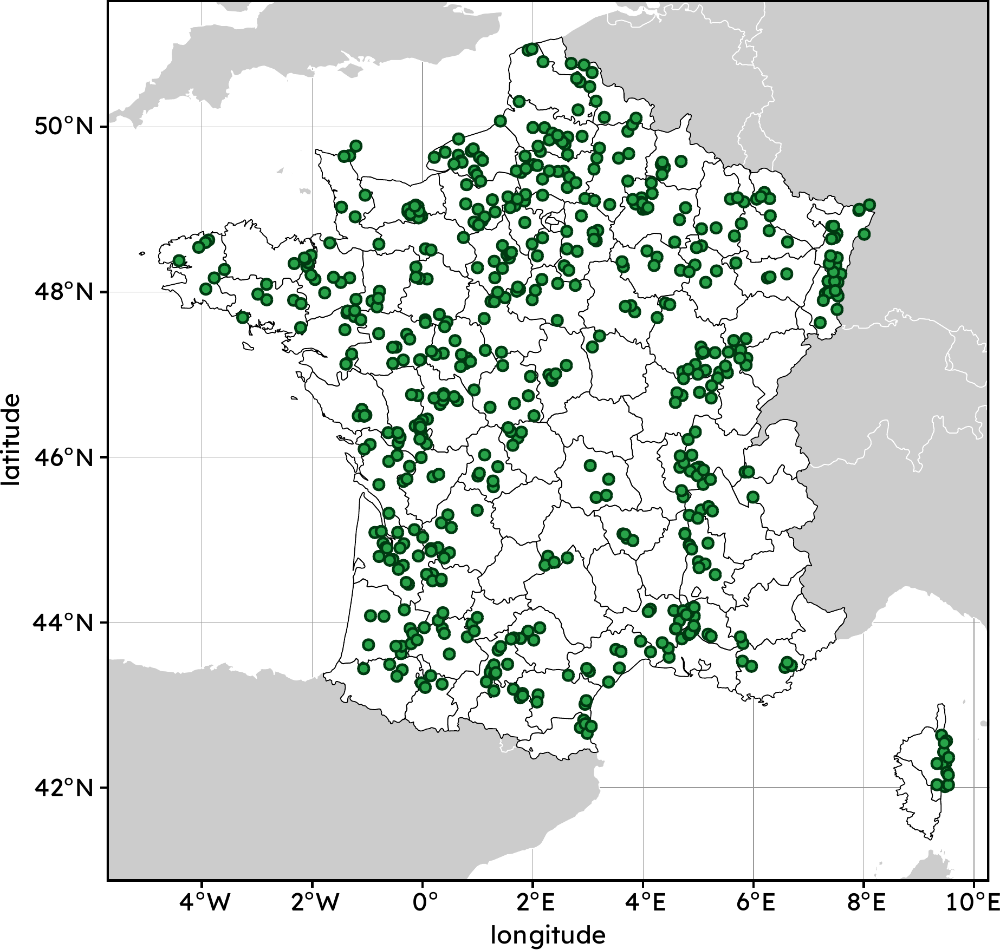{#fig-eni500 width=75%}

### Constraints
The BIODICAPT project collects data on flora, using a protocol that is directly adapted from the one that has been in use in the 500 ENI network since 2012. Therefore there is no need re-sample wild flora in the 500 ENI network

What is of interest to us, is that the BIODICAPT project also aims at using passive acoustic monitoring to identify birds, pollinators, bats and micro-mammals automatically using Song Meters Mini Bat 2 and AI tools (which are not directly the subjects of this report). These data are not collected (yet) within the 500 ENI network.

With the available budget for the BIODICAPT project, it is only possible to finance up to 50 acoustic recorders (+ accessories) for the 500 ENI network. Since this represents less than 10% of the whole 500 ENI network, the sampling design has to be thought of in advance to optimise data collection, model estimations and predictions. 

In addition, as acoustic data was not one of the initial protocols of the 500 ENI network, voluntary observers and farmers have to be motivated, trained, and have to give their consent in order to perform additional protocols on their lands. This means that new data collection for the BIODICAPT project is limited by budget and voluntary participation.

## Objectives {#sec-objectives}
This work aims at answering two questions:

1. Which points, in the 500 ENI network, are the most informative in order to improve the knowledge of species distribution studied within the BIODICAPT project, given previous data collection and current constraints?
2. Which points, in the 500ENI network, will allow to detect an effect of actionable variables on species distribution?


# Material and Methods
## Dataset
The BIODICAPT project started in early-2026, with data collection (wild flora and passive acoustic monitoring) on agricultural plots at regular intervals between April and September. 

The first results on presence-absence of targeted species (inferred from acoustic recordings) are expected for late-2026 to early-2027. In the meantime, sampling designs for the 500 ENI network can be explored through publicly available data and simulations. 

The locations of the fields in the BIODICAPT network (~ 125 fields) and in the 500 ENI network (~ 500 fields) can be used to compute local environmental data and simulate realistic species distribution to find the best sampling designs for this project.

### Environmental data
Environmental data was extracted from several sources:

- [CHELSA-monthly](https://www.chelsa-climate.org/)
- [CORINE Land Cover](https://land.copernicus.eu/en/products/corine-land-cover/clc2018)
- Night time light data [@li_harmonization_2025]
- Elevation data [Elevatr r-package](https://github.com/usepa/elevatr)
- NDVI data [Earthdata (NASA website)](https://www.earthdata.nasa.gov/topics/land-surface/normalized-difference-vegetation-index-ndvi/data-access-tools)
- [Small Woody Features](https://land.copernicus.eu/en/products/high-resolution-layer-small-landscape-features/small-woody-features-2018)
- [Pesticides](https://datadryad.org/dataset/doi:10.5061/dryad.g4f4qrg0p)

Quantitative datasets were simply projected into the target raster grid while the qualitative dataset (CORINE Land Cover or CLC for short) was converted into two layers for each category inside it:

- One where each pixel contains the distance to the closest pixel of the category
- One where each pixel contains the proportion of pixels containing the category within a fixed range ($\sqrt{2 \times \text{res}^2}$)

Resolution ($res$) was chosen to be equal to 5 km, which is a good middle ground between local and global scale. Therefore, all rasters contains pixels of appoximately 5x5 km.

**A few examples of the collected environmental rasters:**


::: {.panel-tabset}
#### Temperatures
```{bash}
#| echo: false
f=../outputs/maps/chelsa_tas.pdf
dpi=300
# page size in pixels at the chosen dpi
read W H < <(pdfinfo "$f" | awk -v d=$dpi '/Page size/ {printf "%d %d", $3*d/72, $5*d/72}')

pdftoppm -png -r $dpi -singlefile \
  -x $(( W*30/100 )) -y $(( H*0/100 )) \
  -W $(( W*40/100 ))  -H $(( H*100/100 )) \
  "$f" ./images/chelsa_tas
```
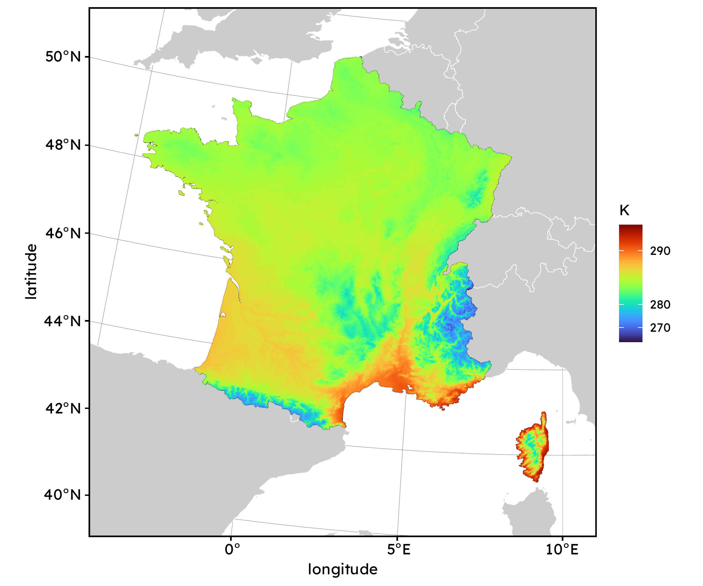{#fig-chelsa_tas width=80%}

#### Land Cover
```{bash}
#| echo: false
f=../outputs/maps/corine.pdf
dpi=300
# page size in pixels at the chosen dpi
read W H < <(pdfinfo "$f" | awk -v d=$dpi '/Page size/ {printf "%d %d", $3*d/72, $5*d/72}')

pdftoppm -png -r $dpi -singlefile \
  -x $(( W*25/100 )) -y $(( H*0/100 )) \
  -W $(( W*50/100 ))  -H $(( H*100/100 )) \
  "$f" ./images/corine
```

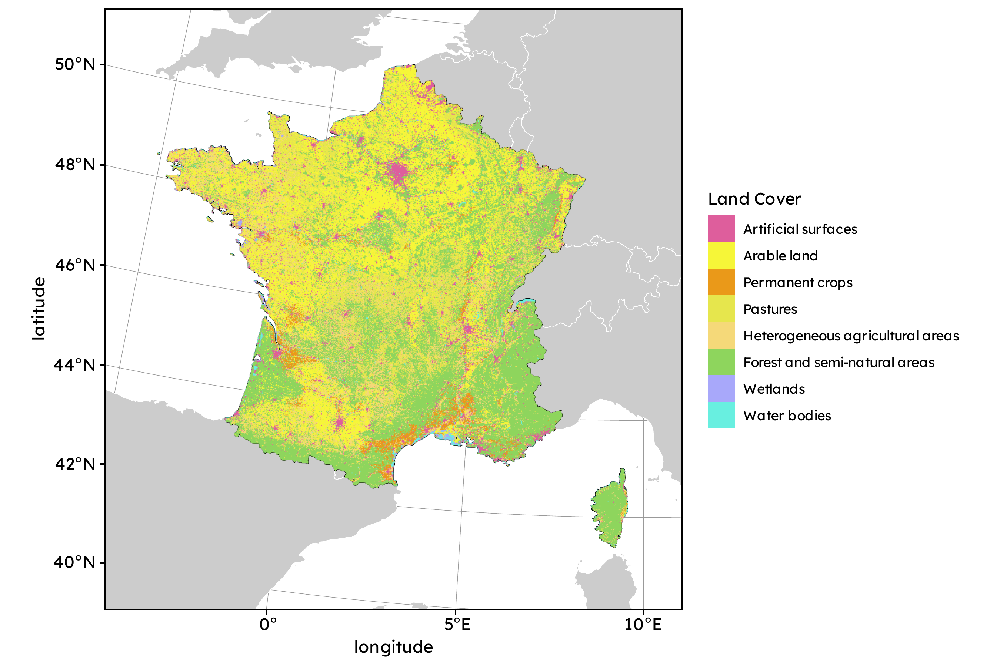{#fig-CLC width=100%}

#### NDVI
```{bash}
#| echo: false
f=../outputs/maps/ndvi.pdf
dpi=300
# page size in pixels at the chosen dpi
read W H < <(pdfinfo "$f" | awk -v d=$dpi '/Page size/ {printf "%d %d", $3*d/72, $5*d/72}')

pdftoppm -png -r $dpi -singlefile \
  -x $(( W*30/100 )) -y $(( H*0/100 )) \
  -W $(( W*40/100 ))  -H $(( H*100/100 )) \
  "$f" ./images/ndvi
```
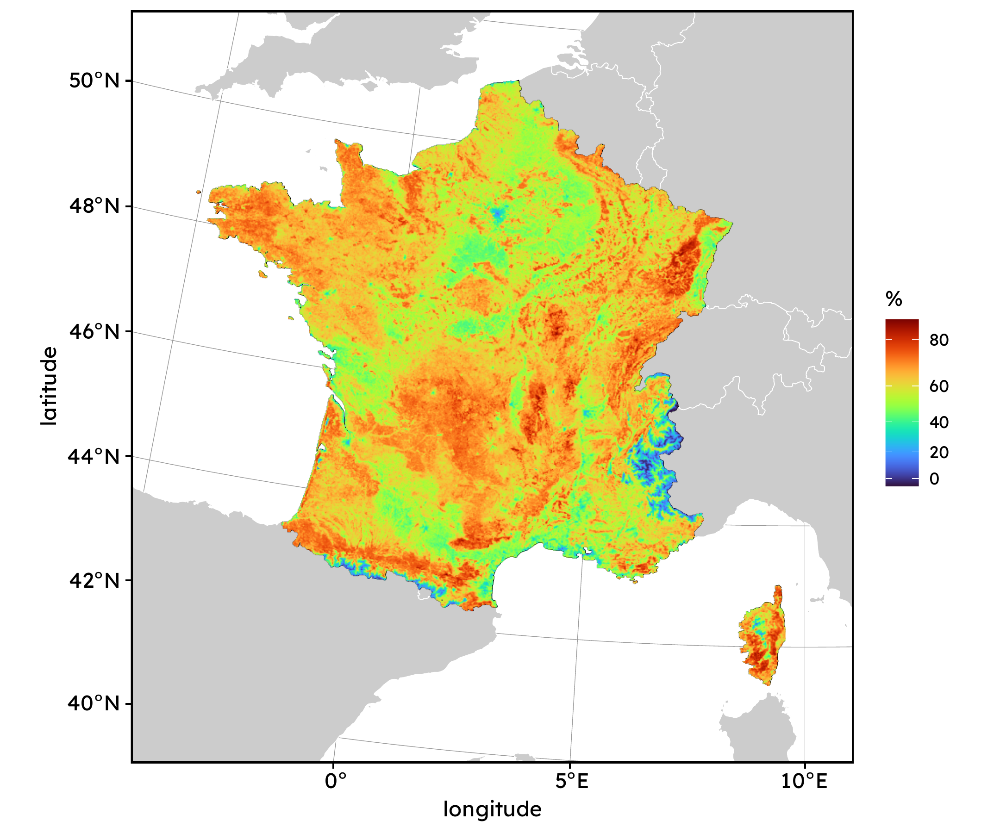{#fig-ndvi0 width=80%}

#### Light pollution
```{bash}
#| echo: false
f=../outputs/maps/light_pollution.pdf
dpi=300
# page size in pixels at the chosen dpi
read W H < <(pdfinfo "$f" | awk -v d=$dpi '/Page size/ {printf "%d %d", $3*d/72, $5*d/72}')

pdftoppm -png -r $dpi -singlefile \
  -x $(( W*30/100 )) -y $(( H*0/100 )) \
  -W $(( W*40/100 ))  -H $(( H*100/100 )) \
  "$f" ./images/light_pollution
```
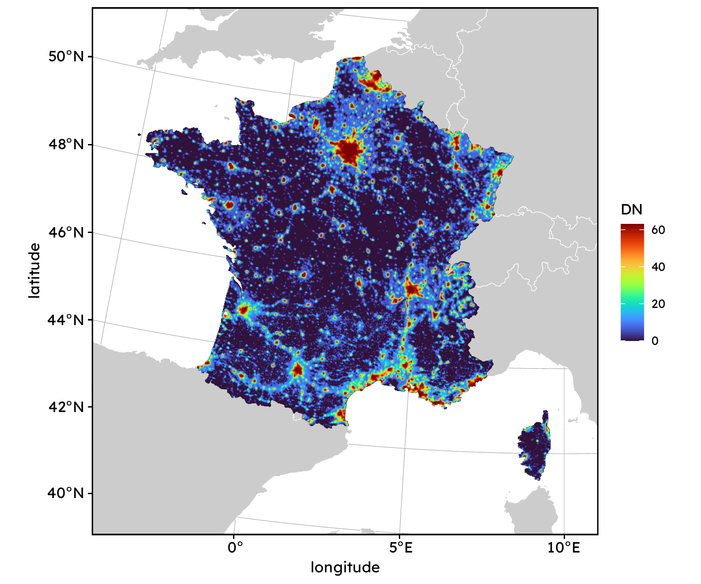{#fig-light-poll width=80%}
:::

### Simulation of species distributions
Species distributions are simulated using the `virtualspecies` R-package [@virtualspecies].

This package takes a multi-layered raster as input (containing all environmental data layers stacked together) and selects a credible "ecological niche" within a PCA computed on the values of each pixel of this raster. This generates a "habitat suitability" index, from which a probability of occurence and ultimately presence-absence observations of the simulated species can be deduced. For more details please see the [tutorial for `virtualspecies`](https://borisleroy.com/virtualspecies_tutorial).

In order to approximate real species relative abundance, a sample of the STOC dataset [@valle_data_2026] was used as reference. It contains the real observations of 40 bird species over more than 7000 locations in France, in varying contexts. The presence rate of each species was used as a prevalence rate in the simulations.


```{bash}
#| echo: false
f=../outputs/simulations/sim_rank-occurence_stoc.pdf
dpi=300
# page size in pixels at the chosen dpi
read W H < <(pdfinfo "$f" | awk -v d=$dpi '/Page size/ {printf "%d %d", $3*d/72, $5*d/72}')

pdftoppm -png -r $dpi -singlefile \
  -x $(( W*30/100 )) -y $(( H*0/100 )) \
  -W $(( W*40/100 ))  -H $(( H*100/100 )) \
  "$f" ./images/sim_rank-occurence_stoc
```
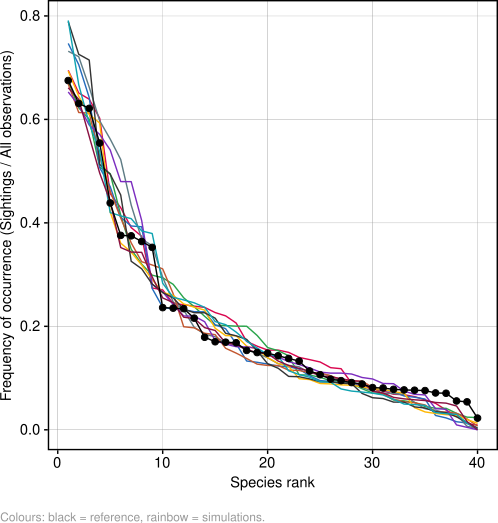{#fig-roc_stoc width=75%}

`virtualspecies` generates credible species niches. However, species generated with this method have no ecological meaning, and should be interpreted with this limit in mind. Therefore our results will only be theoretical and will be focused mainly on the methods.

## Model
To model the distribution of our simulated species over France's metropolitan area, we use a specific type of Species Distribution Models (SDM): a Joint Species Distribution Models (JSDM). These models make use of several species distributions to find *latent* links between them, which supposedly improves the prediction accuracy[^2].

[^2]: JSDM are usually opposed to single SDMs (Species Distribution Models applied to one species) and SSDMs (Stacked SDMs: mutliple SDMs glued together, with no link between them).

### HMSC
For this work, HMSC (Hierarchical Modelling of Species Communities) is a good fit. It is a JSDM developped by Ovaskainen et al. (2017) [@ovaskainen_how_2017], and distributed as an open-source R-package on [GitHub](https://github.com/hmsc-r/HMSC/) [@tikhonov_joint_2020]. Due to its *relative* simplicity and ease of use, it is undoubtebly the most widely used JSDM in the last years. Its principle is summarised in the next figure, extracted from its original publication [@ovaskainen_how_2017]:

![Copy of Figure 4 from Ovaskainen et al. (2017) [@ovaskainen_how_2017]](./images/figure4_ovaskainen_2017.png){#fig-HMSC width=100%}

In this study, only $X$ (environmental variables) and Spatio-temporal context (site co-occurences) will be used to make predictions on $Y$ (presence / absence of species).

### Other models?
::: {.callout-caution collapse="true"}
## Work in progress...

Along with HMSC, the use of GJAM is under consideration, as well as other SDMs: RF, SSDM, deep-SDMs, ...

↳ This section will be updated if/when new models are added to pthe project.
:::

## Adaptive sampling 
### Workflow
Overall, the goal is to find the best 50 locations in the 500 ENI network to add to the BIODICAPT project in order to answer the questions of this study (@sec-objectives). 

In details, HMSC will first be fitted on the simulated presence observations of the 40 bird species at the BIODICAPT locations. Then, a new model will be fitted on the simulated presence observations in BIODICAPT and 50 locations of the 500 ENI network, chosen according to different strategies. Finally, metrics will be used to compare the "base" model to the "retrained" one, to see if there was any gain in quality of prediction and/or the estimation of the effect of actionable variables thanks to the addition of new samples from the 500 ENI network.

This process will be repeated 10 times, each time using a different set a 40 simulated species distributions (with prevalences based on the same STOC occurence reference), so that bias originating from the simulations can be averaged.

Here is a visual summary of the process :

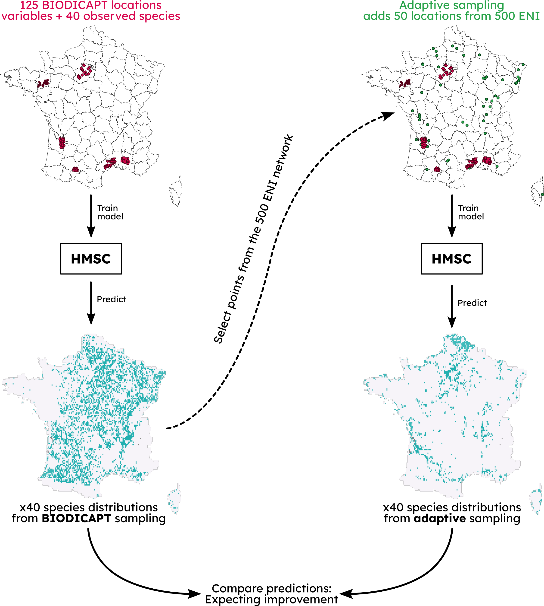{#fig-OED-BIODICAPT width=80%}

### Selecting new samples
Now the question you should be asking yourself is "how do you choose which points of 500 ENI should be added to the BIODICAPT dataset that is used to fit HMSC?".

We compared several strategies :

1. **Random sampling**: points are chosen at random in the 500 ENI network, which is a classical sampling design, but very naive.
2. **Gap-filling**: points are chosen to be a far as possible to the point that were sampled previously. By construction, this strategy adds points that are in a different geo-ecological context than the points sampled initial, which should broaden the range of environmental data and species observed.
3. **Max-uncertainty**[^3]: chooses the points for which the model is the most uncertain of its predictions (aka where the predictions are the most variable). This can either be done one time (for which points is the base model the most uncertain about?) or in several parts, because adding the most uncertain points is likely to change which points the model is the most uncertain about since we changed its training dataset. 

[^3]: max-uncertainty is often used in active learning methods, which is a connected field of study.

These strategies are directly inspired from a similar study [@mondainmonval_adaptive_2024], though we are using a jSDM model instead of an Ensemble of SSDMs, and that our "adaptive sampling" strategy adds points, instead of changing the mix of sampled areas (in practice in the real world, it is often a new funding source that influences sampling; changing the sampling locations is impractical for logistic reasons and loses past historic data).

However, the "max-uncertainty" strategy of the study we take inspiratin from is only a proxy for prediction accuracy (and a heuristic one). Though it is a good proxy, it does not directly answers the questions of our study (@sec-objectives). Therefore, we explore two additional strategies, through the use of **OED criteria**[^4], for a 4th strategy :

4. **Criteria-optimal**: chooses the points that maximises the information according to an optimality criteria.

[^4]: Wikipedia has a good introduction to these criteria, see [this page](https://en.wikipedia.org/wiki/Optimal_experimental_design#Minimizing_the_variance_of_estimators)

### OED introduction
Which criteria should we use for this project?

The initial questions of this work can be reformulated as:

1. Which adaptive design minimises the model's uncertainty in its predictions?
2. Which adaptive design will enable to get the best estimate of the effect of our actionable variables?

Those are different goals, which are assessed with different criteria:

1. **I-optimality**, whose goal is to minimise the average prediction variance over the design space (aka our predictions).
2. **Ds-optimality**[^5], whose goal is to minimise the volume of the confidence ellipsoid for target parameters $\theta_1$ (aka the actionable variables), after accounting for the uncertainty induced by estimating "nuisance" parameters $\theta_2$ (aka the other, non-actionable, variables).

[^5]: FYI: D-optimality (not Ds-optimality) is the most widely used OED criteria. It is a special case of Ds-optimality which aims at maximising the determinant of the information matrix of the design to minimise the volume of the confidence elliposid **for the entire set of parameters** $\theta$. D-optimality results in maximising the differential Shannon information of the parameter estimates, which is very practical for Bayesian models.

However, since HMSC is a bayesian model with latent variables (due to site random effects), these optimisation criteria, that are making use of the Fisher Information Matrix (FIM), are quite difficult (read as 'impossible') to actually compute within an acceptable time frame, even with a decent computing capacity. Therefore, reasonable approximations of these criterion are used in this study. We compare the expected criteria computed from these approximations (obtained from the "base" BIODICAPT-only models) to the realised criteria computed from the posterior distributions (obtained from the retrained BIODICAPT+500 ENI models) in [@sec-res-approx] to validate these approximations.

## Setting and notation {#sec-notation}

### HMSC
As stated above, HMSC is a Bayesian model with random site effects. More specifically, since we are interested in presence-absence data in this study: it is a probit model with latent factors. For site $i$, species $j$, random level $l$, and latent factor $h$ within that level, the observed presence $y_{ij}$ is a thresholded version of the latent $z_{ij}$:

$$
\begin{aligned}
    z_{ij} = x_i^\top \beta_j + \sum_{l}\sum_{h} \lambda_{lhj}\,\eta_{lhi} + \varepsilon_{ij},
    \\
    \text{with } y_{ij} &= 1 \text{ when } (z_{ij} > 0)\\
    \varepsilon_{ij} &\sim\mathcal N(0,1)\\
    \operatorname{Cov}(\eta_{lh\cdot}) &= K_{lh}\\
    \beta_j &= (\beta_{S,j},\; \beta_{N,j})
\end{aligned}
$$

With:

- $x_i$ the covariates at site $i$.
- $S$ the set of $s$ covariates we want to estimate precisely (e.g. the actionable variables) among the whole set of $p$ parameters $\beta$, and $N$ is the set containing the intercept and the other covariates ($p - s$ variables).
- $\eta_{lhi}$ is the score of the factor ($l$, $h$) at site $i$. It is a latent variable, not observed, correlated across units with $K_{lh}$.
- $\lambda_{lhj}$ is the loading of species $j$ on factor ($l$, $h$). It says how strongly, and in which direction, the species responds to that latent gradient. Two species with loadings of the same sign co-occur more than the covariates alone predict. This is how co-occurrence enters the model, through the residual association matrix.
- $\varepsilon_{ij}$ is the residual error in the probit model. Its variance is fixed to 1, since with binary data it cannot be separated from the scale of $\beta$.

The matrix $K_{lh}$ depends on the type of random level. For a site (unit) non-spatial level: $K_{lh} = I$ (independent units).

::: {.callout-note collapse="true"}
### Other random level
HMSC can also be used with a spatial level. In this case, $K_{lh} = \exp(-d/\alpha_{lh})$ with $d$ the matrix of pairwise distances between units.
:::

Equivalently, we can write 

$$
\boxed{y_{ij} \sim \text{Bernoulli}\big(\Phi(x_i^\top\beta_j + \sum_{l,h}\lambda_{lhj}\eta_{lhi})\big)}
$$

With $\Phi$ the standard normal cumulative distribution function (cdf).


### Fisher Information {#sec-fisher-approx}
The Fisher information matrix $M$ measures how much a design $X$ tells us about the parameters. For common GLMs, $M$ is known in closed form [@atkinson_elemental_2014]. $M$ is necessary to compute OED criteria.

Unfortunately, it is not easily obtainable for HMSC, which is a complex non-linear (binary outcome) bayesian model with random effects. 

However, in our study we do not have to explore the entirer space of experimental designs for our model. With BIODICAPT sites, we already have an initial estimation of parameters for our model. Therefore, we can make the assumption that adding new sites from the 500 ENI network will change estimations, but not by huge amounts. The estimators of the parameters are already limited by our initial BIODICAPT design, which means that their is a smaller "remaining" space to explore around each parameter. 

Therefore, for this study, we chose to use an approximation for GLMMs [similarly to @breslow_approximate_1993; @mentre_optimal_1997; @waite_designs_2015] for our model. 

*The idea* is that any smooth function looks approximately linear if you zoom close enough. With our current sampled areas, the plausible space around each parameter is already reduced, which enables us to replace the non-linear probit model with a simpler linear (Gaussian) model around an intial estimation of $\hat\beta_j$ (which we get from the posteriors from the base BIODICAPT model). With this approximation we get a *working model*, that approximates HMSC:

$$
\Phi(x_i^\top\beta_j) \approx \Phi(x_i^\top\hat\beta_j) + \phi(x_i^\top\hat\beta_j)\, x_i^\top(\beta_j - \hat\beta_j)
$$


::: {.callout-important collapse="true"}
#### Limits of the approximation
This only gives use access to *locally* optimal designs.

If $\hat\beta_j$ is close enough to the true $\beta_j$ then the approximation is a good representation of the reality but if the base BIODICAPT-only model is poorly estimated, then the computed "optimality" will be wrong.
:::

Once linearised, the model behaves like a weighted linear regression for which the Fisher Information Matrix is the usual $M = X^\top V^{-1} X$, with $V$ the total covariance of the working responses. For each species $j$, applying the Gaussian formula to the working model $y_j \sim \mathcal N(X\beta_j,\, V_j)$ gives:

$$
\boxed{\; M_j \;\approx\; X^\top V_j^{-1} X \;=\; X^\top\bigl(W_j^{-1} + G_j\bigr)^{-1}X \;}
$$

Where:

- $W_j^{-1}$ is the observtion noise from Bernoulli/probit sampling.
- $G_j$ is the covariance induced by the latent factors.

::: {.callout-note collapse="true"}
#### Detailed $W$ and $G$
From the definition of HMSC above, $G_j$ is the latent term of HMSC: 

$$
G_j = \sum_{l,h} \mathbb E(\lambda_{lhj}^2)\, K_{lh}
$$.

With a non-spatial site level, $K_{lh}=I$ so $G_j$ is diagonal. With a spatial level, $G_j$ would have off-diagonal values and the sum would no longer reduces to simple weights.

In addition, since the approximation considers that observations at different sites are independent, then $W_j^{-1}$  is diagonal (any dependence between sites is carried by $G_j$) and can be added to $G_j$, which is also diagonal. It is written:

$$
W_j = \operatorname{diag}(w_{1j},\dots,w_{nj}), \qquad \text{with }
w_{ij} = \frac{\varphi(\mu_{ij})^2}{\Phi(\mu_{ij})\bigl(1-\Phi(\mu_{ij})\bigr)}
$$

With 
- $\mu_{ij} = x_i^\top\hat\beta_j$,
- $\varphi$ the standard normal pdf, it is how fast the probability $\mathbb{p}=\Phi(\mu)$ changes when $\mu$ changes. If $\mathbb{p}$ barely moves when $\beta$ changes, data cannot tell you much about $\beta$.
- $\Phi(1-\Phi)$ the Bernoulli variance $\mathbb{p}(1-\mathbb{p})$. It is largest at 50%.

The expression of $w_{ij}$ is derived from [@atkinson_elemental_2014, table 2 and lemma 1].
:::

::: {.callout-important collapse="true"}
###### Limits of this approximation
- Linearisation around $\hat\beta_j$ evaluates $w_{ij}$ at the conditional predictor $\mu_{ij}$ with random effect set to 0.
- Each species has its own $M_j$. The cross-species dependence shared through $\eta$ is ignored, as each $M_j$ treats a species on its own.
:::


## Ds-optimality {#sec-ds}
### Formal definition
We are rarely interested in all the parameters equally. Let's split $\beta_j$ into two sets:

- $\theta_1 = \beta_{S,j}$ the $s$ parameters of interest.
- $\theta_2 = \beta_{N,j}$ the $(p-s)$ "nuisance" parameters.

In this case, the Fisher information matrix $M$ can be partitioned accordingly (see [@yi_ds-optimal_2015] eq. 3.3):

$$
\begin{aligned}
M &= \begin{pmatrix} M_{11} & M_{12} \\ M_{21} & M_{22} \end{pmatrix}
\end{aligned}, \text{\quad with } X = [X_1 X_2]
$$

To find the design that best estimates parameters, a popular criterion is the ${D}$-criterion $\Psi_{D}$ [@wald_efficient_1943; @kiefer_optimum_1959]. By definition, the design that best estimates parameters is a design that maximises:

$$
\Psi_{D} \;=\; \log\det M \;=\; -\log\det \bigl[M^{-1}\bigr]
$$

But, in reality, the ${D}$-criterion is a special case of the ${D_s}$-criterion (where $s = p$), which is written:

$$
\boxed{\;\Psi_{D_s} \;=\; \log\det M_{1|2} \;=\; -\log\det \bigl[M^{-1}\bigr]_{11}\;}
$$

::: {.callout-note collapse="true"}
#### Hidden steps
By the block-inversion formula[^6], the covariance of $\theta_1$ when estimated together with $\theta_2$ is (see [@yi_ds-optimal_2015] eq. 3.8, asymptotic (Cramér-Rao-like) covariance):

[^6]: Again, wikipedia explains this very well, see [this page](https://en.wikipedia.org/wiki/Block_matrix#Inversion).


$$
\operatorname{Cov}(\hat\theta_1) \;=\; (M^{-1})_{11} \;=\; \bigl(\underbrace{M_{11} - M_{12}\,M_{22}^{-1}\,M_{21}}_{M_{1|2}\;=\;\text{Schur complement}}\bigr)^{-1}.
$$

$M_{1|2}$ is the information about $\theta_1$ that remains after removing what is confounded with the nuisance parameters $\theta_2$.

If the columns of $X$ for $\theta_1$ and $\theta_2$ are orthogonal ($M_{12} = 0$), then $M_{1|2} = M_{11}$ and the nuisance parameters cost nothing. If they are strongly correlated, $M_{1|2}$ is much smaller than $M_{11}$.
:::

Using $\det M = \det M_{22}\cdot\det M_{1|2}$, it can also be written into a form that is actually easier to compute:

$$
\Psi_{D_s} \;=\; \log\det M \;-\; \log\det M_{22}
$$

::: {.callout-note collapse="true"}
#### Special cases
- If $s = p$ Ds-optimality becomes the D-optimality.
- If $s = 1$: Ds-optimality becomes the C-optimality.
:::

In practice, for a candidate design, we compute $M_j$ for each species $j$ and evaluate $\Psi_{D_s}(M_j) = \log\det M_{1|2,j}$. To summarise a design we use $\sum_j \Psi_{D_s}(M_j)$. Note that this ignores cross-species dependence shared through $\eta$.


### Adding a site {#sec-adding-site-ds}
For each site added to the sampling design, the criterion can be computed again, and compared to the previous one. The design with the highest Ds-criterion being the closest to Ds-optimality. We call this gain $\Delta\Psi_{D_s}$ with:

$$
\Delta\Psi_{D_s} = \Psi_{D_s}(M') - \Psi_{D_s}(M)
$$

The naive way of computing $\Delta\Psi_{D_s}$ would be to fit our model (HMSC) on the initial (BIODICAPT) plus a new point (from 500 ENI), computing $\Psi_{D_s}(M')$ and comparing it to the previous $\Psi_{D_s}(M)$.

However, this would be computationally heavy for numerous new points and/or combinations of points, as HMSC (being a bayesian model) is not exactly cheap to refit.

Another way is to use the Sherman–Morrison–Woodbury formula [@sherman_morrison_1950], which enables to compute the inverse "rank-1 update" of a previous invertible matrix. This avoids having to compute new posteriors. 

::: {.callout-note collapse="true"}
#### Hidden steps
This formula states that for a matrix $M'$ defined as above, then:

$$
M'^{-1} = M^{-1} - w \frac{M^{-1} x x^\top M^{-1}}{(1 + w x^\top M^{-1} x)}
$$

But to compute $\Delta\Psi_{D_s}$, we are only interested in $\det \bigl[M'^{-1}\bigr]_{11}$. 

Let's define $A = \bigl[M^{-1}\bigr]_{11}$ (so $A^{-1} = M_{1|2}$) and $a = [M^{-1}x]_{1:s}$, the first $s$ components of $M^{-1}x$. Then:

$$
\bigl([M'^{-1}]_{11}\bigr) = A - w \frac{aa^\top}{(1 + w x^\top M^{-1} x)}
$$

With $\gamma = \frac{w}{1 + w\,x^\top M^{-1}x}$ and the application of the matrix determinant lemma[^7], we get:

$$
\begin{aligned}
\det\bigl([M'^{-1}]_{11}\bigr) &= \det(A - \gamma\,aa^\top)
  = \det(A)\,\bigl(1 - \gamma\,a^\top A^{-1}a\bigr)\\
  &= \det\bigl([M^{-1}]_{11}\bigr)\left(1 - \frac{w\,a^\top M_{1|2}\,a}{1 + w\,x^\top M^{-1}x}\right)
\end{aligned}
$$
$$
\begin{aligned}
    \Rightarrow \Delta\Psi_{D_s}
        &= -\log\det[M'^{-1}]_{11} + \log\det[M^{-1}]_{11}\\
        &= -\log\!\left(1 - \frac{w\,a^\top M_{1|2}\,a}{1 + w\,x^\top M^{-1}x}\right)
\end{aligned}
$$

[^7]: Hm, have you heard of wikipedia? see [here](https://en.wikipedia.org/wiki/Matrix_determinant_lemma).
:::

Let $x_c$ be a candidate site with a total response variance of $v = \frac{1}{w_{cj}} + g_{cc}$ (probit noise plus random effect, $g_{cc} = (G_j)_{cc}$). Its weight is $w = \frac{1}{v}$. 

With no random effect this reduces to $w = w_{cj}$. Then the new information matrix $M'$ with the added site is derived directly from $M$ with:

$$
M' = M + w\, x x^\top .
$$

Using this, the approximate gain (because we are not using real full posteriors) in the Ds-criterion can be computed **without refit** using: 

$$
\boxed{\;\Delta\Psi_{D_s} \;=\; -\log\!\left(1 \;-\; \frac{w\; a^\top\, M_{1|2}\, a}{1 + w\, x^\top M^{-1} x}\right)\;}
$$


::: {.callout-important collapse="true"}
#### Limits of this strategy
The formula assumes $w > 0$, $M$ is invertible, and that a single candidate is added at a time.

It might be possible to look into a "rank-k" generalisation [@woodbury1950inverting] but that's another work entirely.
:::

With this formula, a greedy selection (add the best candidate, update $M$, repeat) is relatively cheap to compute, HMSC never has to be refitted. 

### Adding random effects {#sec-correlated}

When adding a candidate, $M'$ becomes:

$$
\begin{aligned}
    M' = X'^\top V'^{-1} X',&\\
    &\text{with } X' = \begin{pmatrix} X \\ x^\top \end{pmatrix},\\
    &V' = \begin{pmatrix} V & k \\ k^\top & v \end{pmatrix}, \qquad
\end{aligned}
$$

With:

- $v$: the total variance of the responses at the candidate (random effect + residual),
- $k$: the $n \times 1$ vector of covariances between the candidate and the sites already in the design.

Inverting $V'$ by blocks gives:

$$
V'^{-1} =
\begin{pmatrix}
P + \dfrac{P k\, k^\top P}{\sigma_c^2} & -\dfrac{P k}{\sigma_c^2} \\[2mm]
-\dfrac{k^\top P}{\sigma_c^2} & \dfrac{1}{\sigma_c^2}
\end{pmatrix}.
$$

With :

- $P = V^{-1}$
- $\sigma_c^2 = v - k^\top P k$, it is the conditional variance of the candidate given the existing sites (the Schur complement of $V$ in $V'$):

::: {.callout-note collapse="true"}
#### Detailed inversion
By definition:
$$
\begin{aligned}
    V'V'^{-1} &= I\\
    \begin{pmatrix} V & k \\ k^\top & v \end{pmatrix} \begin{pmatrix} Q & c \\ c^\top & d \end{pmatrix} &= \begin{pmatrix} I_n & 0 \\ 0 & 1 \end{pmatrix}
\end{aligned}
$$

with $Q$ an $n \times n$ matrix, and $c$ an $n \times 1$ matrix. Then, the system can be written as a system of 4 equations:

$$
\begin{aligned}
    \begin{cases}
        VQ + kc^\top = I\\
        Vc + kd = 0\\
        k^\top Q + v c^\top = 0\\
        k^\top c + v d = 1\\
    \end{cases}
\end{aligned}
$$

By solving for $c$ using the 2nd equation, then solving for $d$ using the last equation we get

$$
\begin{aligned}
    c = -Pkd &\text{, with } P = V^{-1}\\
    d = \frac{1}{\sigma_c^2} &\text{, with } \sigma_c^2 = v - k^\top P k\\
\end{aligned}
$$

Then, with $P = P^\top$:

$$
c = - \frac{Pk}{\sigma_c^2} \qquad \text{and} \qquad c^\top = - \frac{k^\top P}{\sigma_c^2}
$$

And finally, using equation 1 and $c^\top$:

$$
Q = P + \frac{Pkk^\top P}{\sigma_c^2}
$$
:::

::: {.callout-note collapse="true"}
#### For information
$k^\top P k$ is the part of the candidate's variance that is predictable from the existing sites, so $\sigma_c^2$ is the variance that is genuinely new.
:::

Then, $M'$ is simply obtained by multiplying out $X'^\top V'^{-1} X'$:

$$
M' = \underbrace{X^\top P X}_{M} + \frac{(x-u)(x-u)^\top}{\sigma_c^2} \text{, with } u = X^\top P k
$$


::: {.callout-note collapse="true"}
#### For information
$X^\top P k$ is the part of the candidate's covariates that can be predicted from the existing sites through the spatial correlation, so $x - u$ is what remains.
:::

Which we note

$$
\boxed{\; M' = M + \frac{r\, r^\top}{\sigma_c^2} \;} \qquad \text{with } r = x - X^\top P\, k
$$

#### Delta Ds-criterion
We recognise the expression $M' = M + w\,xx^\top$ that we computed earlier, with:

$$
x \;\to\; r, \qquad w \;\to\; \frac{1}{\sigma_c^2}.
$$

Therefore, replacing in $\Delta\Psi_{D_s}$ we get:

$$
\boxed{\;\Delta\Psi_{D_s} = -\log\!\left(1 - \frac{a^\top M_{1|2}\, a}{q}\right)\;}
$$

With $a = [M^{-1}r]_{1:s}$ and $q = \sigma_c^2 + r^\top M^{-1} r$, substituting $w = 1/\sigma_c^2$ and $x = r$ in the previous boxed formula and multiplying numerator and denominator by $\sigma_c^2$.

::: {.callout-important collapse="true"}
##### Assumptions and limits
- $V$ is treated as known. In practice it is built from posterior estimates of the random-effect parameters (variance and spatial range) and the residual variance, so the gain is conditional on those estimates.
- As before, a single candidate is added at a time, and $M$ must be invertible.
:::


### Application {#sec-application-ds}

To compute $\Delta\Psi_{D_s}$ we need:

- $a = [M^{-1}r]_{1:s}$, computed from:
    - $M^{-1}$, which is solved from $M$, computed from $X^\top V^{-1} X$, a Fisher-information approximation of the covariance of the posteriors of $\beta_j$.
    - $r = x - X^\top P k$
        - $x$ the vector of new covariates at candidate site $c$
        - $X$ the covariates matrix of the current design
        - $P = V^{-1}$, with $V$ the covariance of responses.
        - $k$ the covariances between the candidate site $c$ and the sites already in the design.All limits of the Ds application hold: plug-in $\hat\beta_j$, one site per unit, and the cross-species dependence through $\eta$ is ignored.
    - $1:s$ the parameters of interest, which are easily indexed.
- $q = \sigma_c^2 + r^\top M^{-1} r$, computed from:
    - $\sigma_c^2 = v - k^\top P k$, computed from:
        - $v$ the variance of the response at candidate site $c$.
    - $k$, $r$ and $M^{-1}$ already computed for $a$
- $M_{1|2}$: the inverse covariance (aka precision) of the estimated $\theta_1$ parameters of interest.

Everything is computed per species $j$, $\Delta\Psi_{D_s}$ is then summed over $j$.

### Evaluation of design {#sec-evaluation-ds}

Once a model has been refitted on BIODICAPT plus the new sites using greedy Ds-optimality, a realised analogue of the criterion is available from the MCMC draws:

$$
\widehat{\Psi}_{D_s} \;=\; -\log\det \widehat{\operatorname{Cov}}_{\text{post}}\!\bigl(\beta_{S,j}\bigr)
$$

If the posterior is approximately Gaussian, this equals $\log\det M_{1|2,j}$ in the limit of a weak prior. The two quantities are not identical: $M_j$ is an expected information evaluated at a plug-in value (obtained from the BIODICAPT initial sites) and ignores the uncertainty on the latent factors, so the realised posterior might be different. 

The realised criterion can therefore be used to check that the designs rank as predicted, but not to recover the same numerical value.

## I-optimality
### Formal definition
When the goal is to predict species well, what matters is the uncertainty of the predictions $\hat y$ at the sites $g$ (not $i$ because the model can be used on site that were not available for training) where the model will be used. In this case, statisticians use I-optimality (for *Integrated*-optimality). It minimises the average prediction variance over a region of interest of $m$ sites, for example a sample of pixels of France or the test sites.

For a point $g$ with covariates $x_g$, the quantity of interest is the predicted probability of presence $p_{gj} = \Phi(x_g^\top\beta_j)$. By the delta method, its variance under the Gaussian approximation is

$$
\operatorname{Var}(\hat p_{gj}) \approx \varphi(\mu_{gj})^2\; x_g^\top M_j^{-1} x_g, \qquad \mu_{gj} = x_g^\top\hat\beta_j
$$

Let $\mathcal G$ be the set of $m$ prediction points. The average prediction variance is

$$
\begin{aligned}
    \frac{1}{m}\sum_{g\in\mathcal G} \varphi(\mu_{gj})^2\, x_g^\top M_j^{-1} x_g \;=\; \operatorname{tr}\!\bigl(M_j^{-1} B_j\bigr),\\
    \text{with } B_j = \frac{1}{m}\sum_{g\in\mathcal G} \varphi(\mu_{gj})^2\, x_g x_g^\top
\end{aligned}
$$


::: {.callout-note collapse="true"}
#### Hidden steps
$x^\top M_j^{-1} x$ is a scalar, therefore:

$$
\begin{aligned}
    x^\top M_j^{-1} x &= \operatorname{tr}(x^\top M_j^{-1} x)\\
               &= \operatorname{tr}(M_j^{-1}\,xx^\top)
\end{aligned}
$$

Why bother: this allows to separate the design-dependent part $M_{j}^{-1}$ from the grid-dependent part $B$, which only needs to be computed once!
:::

$B$ is called the moment matrix of the region. The design that predicts best is the one that maximises:

$$
\boxed{\;\Psi_{I} \;=\; -\operatorname{tr}\!\bigl(M^{-1} B\bigr)\;}
$$

::: {.callout-note collapse="true"}
#### Quick note
Usually, the I-criterion is defined as $\operatorname{tr}\!\bigl(M^{-1} B\bigr)$, which has to be minimised. Here we flip the sign so that the criterion has to be maximised, in order to create consistency with the Ds-criterion.
:::


or in our case:

$$
\Psi_{I} \;=\; -\sum_j \operatorname{tr}\!\bigl(M_j^{-1} B_j\bigr)
$$

::: {.callout-note collapse="true"}
#### Special cases
- If $B = I$, then $\Psi_I = -\operatorname{tr}(M^{-1})$, which is A-optimality. 
- If $B = \varphi(\mu_{gj})^2 x_g x_g^\top$ for a single point, it is the C-optimality of that prediction.
- Dropping the $\varphi^2$ factor gives the criterion on the linear predictor $x_g^\top\beta_j$ instead of the probability (and simplifies computation).
:::

### Adding a site 

We compare I-criteria between designs with:

$$
\Delta\Psi_I = \Psi_I(M') - \Psi_I(M) = \operatorname{tr}(M^{-1}B) - \operatorname{tr}(M'^{-1}B)
$$

With the same notations as @sec-ds: $\Delta\Psi_I$ is positive when the candidate reduces the average prediction variance. 

As before, we avoid refitting HMSC by using the Sherman–Morrison formula. 

::: {.callout-note collapse="true"}
#### Hidden steps

From @sec-adding-site-ds:

$$
M'^{-1} = M^{-1} - \gamma\, M^{-1}xx^\top M^{-1}, \qquad \gamma = \frac{w}{1 + w\,x^\top M^{-1}x}.
$$

Let $b = M^{-1}x$ (all $p$ components, unlike the $a$ of Ds, which kept only the first $s$ parameters of interest). Then:

$$
\operatorname{tr}(M'^{-1}B) = \operatorname{tr}(M^{-1}B) - \gamma\,\operatorname{tr}(b\,b^\top B) = \operatorname{tr}(M^{-1}B) - \gamma\, b^\top B\, b ,
$$

using the cyclic property of the trace. Therefore

$$
\Delta\Psi_I = \gamma\, b^\top B\, b = \frac{w\; x^\top M^{-1} B M^{-1} x}{1 + w\,x^\top M^{-1}x}.
$$
:::

$$
\boxed{\;\Delta\Psi_I \;=\; \frac{w\; b^\top B\, b}{1 + w\, x^\top M^{-1} x}\;}, \qquad b = M^{-1}x
$$

::: {.callout-important collapse="true"}
#### Limits of this strategy
Same as for Ds: the formula assumes $w > 0$, $M$ is invertible, and that a single candidate is added at a time.

In addition, $\Delta\Psi_I$ depends on the choice of the prediction region $\mathcal G$, which must be representative of where the model will be used.
:::


### Adding random effects
With the correlated random effect, the same substitution as for Ds (using $V = W_j^{-1} + G_j$) applies. As a reminder: 

$$
\boxed{\; M' = M + \frac{r\, r^\top}{\sigma_c^2} \;}, \qquad \text{with } r = x - X^\top P\, k, \quad \sigma_c^2 = v - k^\top P k
$$


Which gives:

$$\boxed{\;\Delta\Psi_I \;=\; \frac{b_r^\top B\, b_r}{q}\;}, \qquad \text{with } b_r = M^{-1}r, \quad q = \sigma_c^2 + r^\top M^{-1} r .$$

::: {.callout-important collapse="true"}
#### Assumptions and limits
- $V$ is treated as known. In practice it is built from posterior estimates of the random-effect parameters (variance and spatial range) and the residual variance, so the gain is conditional on those estimates.
- As before, a single candidate is added at a time, and $M$ must be invertible.
- This criterion targets the predicted probability at the conditional predictor (random effect set to 0), with a first-order delta-method variance. $\varphi(\mu_{gj})$ is evaluated at the plug-in $\hat\beta_j$, like the weights $w$.
:::

### Application {#sec-application-i}

For a candidate site $c$ and a species $j$, computing $\Delta\Psi_I$ needs:

- $B_j = \frac{1}{m}\sum_{g\in\mathcal G} \varphi(\mu_{gj})^2 x_g x_g^\top$, the moment matrix of the region for species $j$. It is a $p \times p$ matrix, computed once per species from the covariates of the $m$ prediction points and $\hat\beta_j$.
- $b_r = M^{-1} r$, computed from:
    - $M^{-1}$, solved from $M = X^\top V^{-1} X$ (same as for Ds). Unlike $a$ for Ds, $b_r$ keeps all $p$ components.
    - $r = x - X^\top P k$, with $P = V^{-1}$ and $k$ as in the Ds application. In the independent case, $r = x$.
- $q = \sigma_c^2 + r^\top M^{-1} r$, with $\sigma_c^2 = v - k^\top P k$. These quantities are the same as for Ds, so the two criteria share all the heavy computations.

The gain is then $\Delta\Psi_{I,j} = b_r^\top B\, b_r / q$, summed over species: $\Delta\Psi_I = \sum_j \Delta\Psi_{I,j}$.

::: {.callout-important collapse="true"}
#### Limits
All limits of the Ds application hold: plug-in $\hat\beta_j$, one site per unit, and the cross-species dependence through $\eta$ is ignored.

The criterion targets the predictions of the linear predictor (or of the probability by the delta method), not the predictions of community composition, which depend on the joint distribution across species.
:::

### Evaluation of design {#sec-evaluation-i}

Once a model has been refitted on BIODICAPT plus the new sites using greedy I-optimality, the realised analogue of the criterion is available from the posterior covariance of $\beta_j$ in the same way as for Ds:

$$
\widehat{\Psi}_{I,j} = -\operatorname{tr}\!\bigl(\widehat{\operatorname{Cov}}_{\text{post}}(\beta_j)\,B_j\bigr) = -\frac1m\sum_{g}\varphi(\hat\mu_{gj})^2\,\widehat{\operatorname{Var}}_{\text{post}}\bigl(x_g^\top\beta_j\bigr)
$$

with $\hat\mu_{gj}$ the posterior mean of the linear predictor. 

The right-hand side is computed from the MCMC draws as the variance across draws of the linear predictor at each grid point, multiplied by $\varphi(\hat\mu_{gj})^2$ and averaged over the grid. It is a delta-method approximation of the posterior variance of the predicted probability.

Same as for Ds, it is used to check that the designs rank as predicted, not to recover the same numerical value.

# Results
## Approximations {#sec-res-approx}
To compute the Fisher Information Matrix (FIM), and thus our criteria, we assumed that HMSC ***could*** be linearised after its initial fit, which we based on BIODICAPT's data collection (see [@sec-fisher-approx]).

Once the model is re-trained on BIODICAPT + the sites chosen inside 500 ENI, we can compare its expected criteria ([@sec-application-ds] \& [@sec-application-i]) to its realised values ([@sec-evaluation-ds] \& [@sec-evaluation-i]), parameters and predictions. This enables us to conduct a high-level check to confirm that the approximation of the FIM do produce the expected results. 

As a reminder, Ds-optimality should be reached when the Ds-criterion is maximal, which should also be when the SD of the estimated fixed parameters for our actionable variables is minimal. On the other hand, I-optimality should be reached when the I-criterion is maximal, which should be when the SD of the predictions is minimal.

**Plotting expected VS realised metrics:**

::: {.panel-tabset}
### Ds-criterion
```{bash}
#| echo: false
f=../outputs/results_analyses/ds-criterion_expected_vs_realised.pdf
dpi=300
# page size in pixels at the chosen dpi
read W H < <(pdfinfo "$f" | awk -v d=$dpi '/Page size/ {printf "%d %d", $3*d/72, $5*d/72}')

pdftoppm -png -r $dpi -singlefile \
  -x $(( W*0/100 )) -y $(( H*0/100 )) \
  -W $(( W*100/100 ))  -H $(( H*100/100 )) \
  "$f" ./images/ds-criterion_expected_vs_realised
```
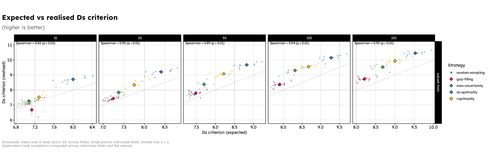{#fig-ds-criterion_expected_vs_realised width=100%}

### Actionable parameters
```{bash}
#| echo: false
f=../outputs/results_analyses/ds-criterion_expected_vs_actionable_SD.pdf
dpi=300
# page size in pixels at the chosen dpi
read W H < <(pdfinfo "$f" | awk -v d=$dpi '/Page size/ {printf "%d %d", $3*d/72, $5*d/72}')

pdftoppm -png -r $dpi -singlefile \
  -x $(( W*0/100 )) -y $(( H*0/100 )) \
  -W $(( W*100/100 ))  -H $(( H*100/100 )) \
  "$f" ./images/ds-criterion_expected_vs_actionable_SD
```
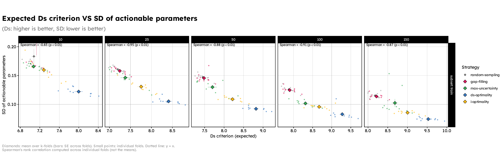{#fig-ds-criterion_expected_vs_actionable_SD width=100%}


### I-criterion
```{bash}
#| echo: false
f=../outputs/results_analyses/i-criterion_expected_vs_realised.pdf
dpi=300
# page size in pixels at the chosen dpi
read W H < <(pdfinfo "$f" | awk -v d=$dpi '/Page size/ {printf "%d %d", $3*d/72, $5*d/72}')

pdftoppm -png -r $dpi -singlefile \
  -x $(( W*0/100 )) -y $(( H*0/100 )) \
  -W $(( W*100/100 ))  -H $(( H*100/100 )) \
  "$f" ./images/i-criterion_expected_vs_realised
```
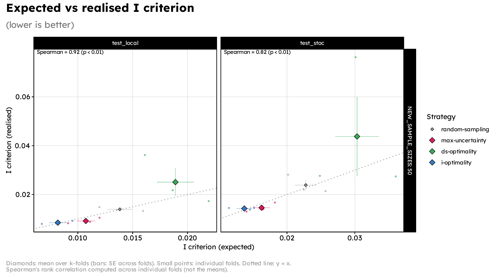{#fig-i-criterion_expected_vs_realised width=100%}

### Predictions
```{bash}
#| echo: false
f=../outputs/results_analyses/i-criterion_expected_vs_predictions.pdf
dpi=300
# page size in pixels at the chosen dpi
read W H < <(pdfinfo "$f" | awk -v d=$dpi '/Page size/ {printf "%d %d", $3*d/72, $5*d/72}')

pdftoppm -png -r $dpi -singlefile \
  -x $(( W*0/100 )) -y $(( H*0/100 )) \
  -W $(( W*100/100 ))  -H $(( H*100/100 )) \
  "$f" ./images/i-criterion_expected_vs_predictions
```
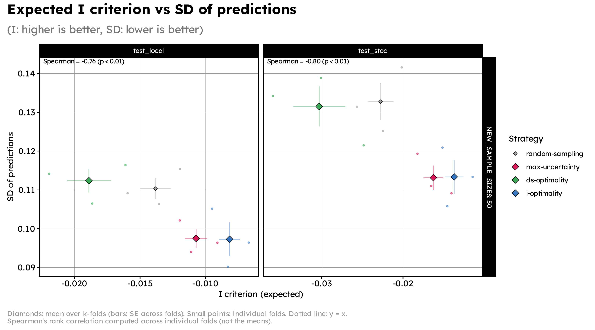{#fig-i-criterion_expected_vs_predictions width=100%}
:::

These plots are aligned with what we hoped to get:

- **Expected and realised Ds-criteria** are strongly positively correlated. Expected Ds-criterion is under realised Ds-criterion: our approximation is conservative and underestimates the gains.
- **Expected Ds-criterion and SD of actionable parameters** are strongly negatively correlated. As Ds is a criterion that minimises the uncertainty of our actionable parameters, this is what we expect.
- **Expected and realised I-criteria** are strongly positevely correlated and mostly within expected boundaries. We notice that the more there are new samples added to the training data, the lower are the expected and realised I-criteria for "gap-filling" strategy (relative to the other strategies): with many new samples added, the gains with a "gap-filling" strategy are lower.
- **Expected I-criterion and SD of predictions** are negatively correlated, although with large variations. This is because, the more new samples are added to the training set, the lower are the gain in SD of predictions for all strategies (except for i-optimality strategy).

Another plot is also worth analysing seperately:
```{bash}
#| echo: false
f=../outputs/results_analyses/ds-criterion_expected_vs_all_parameters_SD.pdf
dpi=300
# page size in pixels at the chosen dpi
read W H < <(pdfinfo "$f" | awk -v d=$dpi '/Page size/ {printf "%d %d", $3*d/72, $5*d/72}')

pdftoppm -png -r $dpi -singlefile \
  -x $(( W*0/100 )) -y $(( H*0/100 )) \
  -W $(( W*100/100 ))  -H $(( H*100/100 )) \
  "$f" ./images/ds-criterion_expected_vs_all_parameters_SD
```
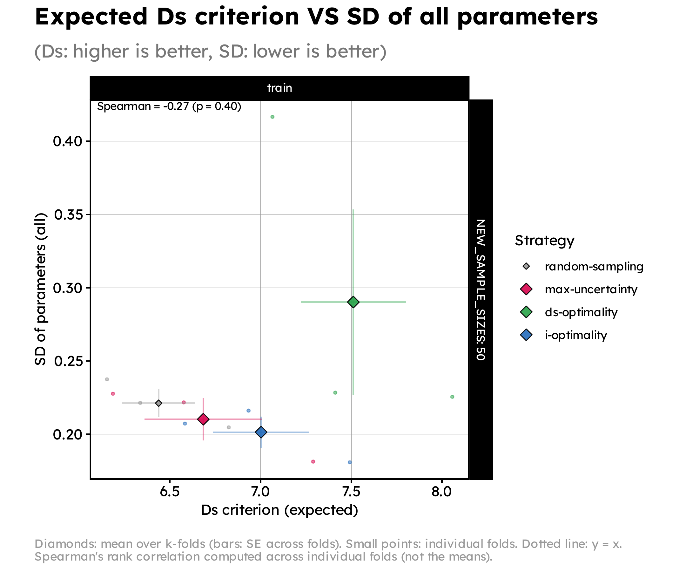{#fig-ds-criterion_expected_vs_all_parameters_SD width=100%}

This figure does not help to validate our approximations but is interesting for at least two reasons:

1. It shows an absence of correlation between Ds-criterion and the SD of all parameters, mainly because of the Ds-optimality strategy: it optimises the estimation of a subset of the parameters, which causes everything else to be treated as nuisance parameters, whose uncertainty do not matter.
2. Strategies *max-uncertainty* and *i-optimality* are built to optimise for best predictions, but here they seem to also bring the SD of all parameters down. This is a side effect of prediction optimisation: to get good predictions, one must estimate parameters as precisely as possible, so the two are linked together[^8], which is what we see here.

[^8]: To really estimate *all* parameters precisely, the use of a D-optimality criterion would be more appropriate, it can be easily computed from our Ds-criterion but is not the subject of this study.

Overall, **the rankings of every strategy are the ones that we expected to obtain**, which validates our approximations. With this in mind, we can explore the implications for our sampling designs, and our results.

## Sampling in 500 ENI

### Estimated parameters 

This subsection is optional as it mainly showcases a subset of the results analysed in the previous section.

::: {.panel-tabset}
#### SD of all parameters
```{bash}
#| echo: false
f=../outputs/results_analyses/Delta_SD_parameters_all.pdf
dpi=300
# page size in pixels at the chosen dpi
read W H < <(pdfinfo "$f" | awk -v d=$dpi '/Page size/ {printf "%d %d", $3*d/72, $5*d/72}')

pdftoppm -png -r $dpi -singlefile \
  -x $(( W*30/100 )) -y $(( H*0/100 )) \
  -W $(( W*40/100 ))  -H $(( H*100/100 )) \
  "$f" ./images/Delta_SD_parameters_all
```
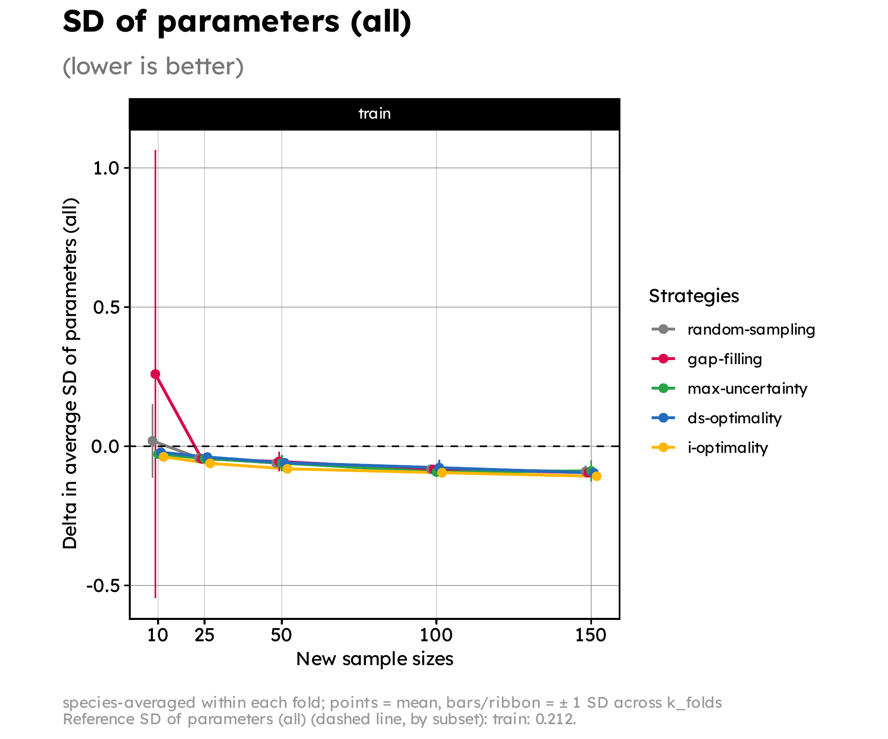{#fig-Delta_SD_parameters_all width=80%}

#### SD of actionable parameters
```{bash}
#| echo: false
f=../outputs/results_analyses/Delta_SD_parameters_actionable_distrib.pdf
dpi=300
# page size in pixels at the chosen dpi
read W H < <(pdfinfo "$f" | awk -v d=$dpi '/Page size/ {printf "%d %d", $3*d/72, $5*d/72}')

pdftoppm -png -r $dpi -singlefile \
  -x $(( W*30/100 )) -y $(( H*0/100 )) \
  -W $(( W*40/100 ))  -H $(( H*100/100 )) \
  "$f" ./images/Delta_SD_parameters_actionable_distrib
```
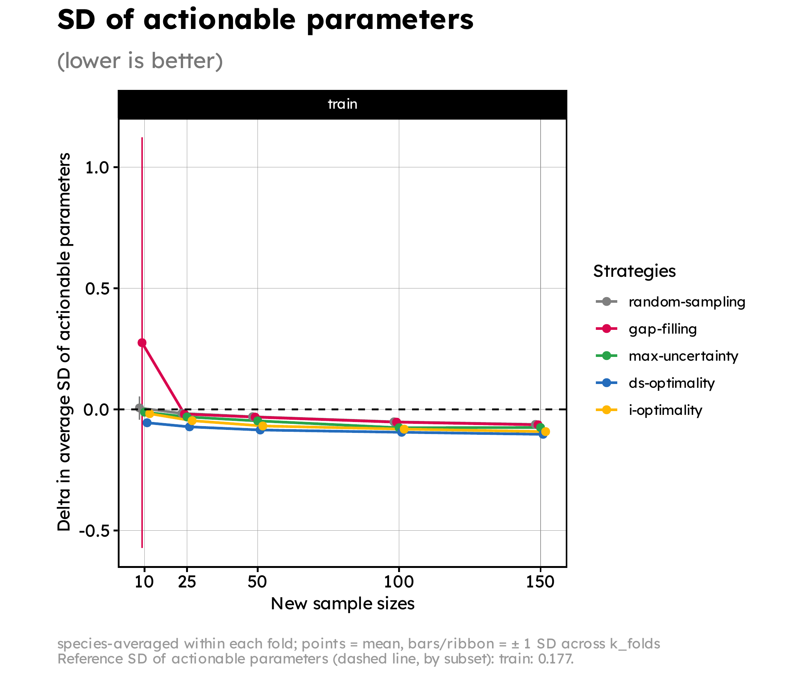{#fig-Delta_SD_parameters_actionable_distrib width=80%}
:::

After the analysis of the previous section, there are no surprises here :

- To improve the mean SD of all parameters, the strategies rank as following (on average, best to worst): i-optimality, max-uncertainty, gap-filling, random-sampling and Ds-optimality.
- However, to improve the mean SD of the actionable parameters only, the strategies rank as following (best to worth): ds-optimality, i-optimality, max-uncertainty, gap-filling and random-sampling (these last two are almost equivalent in gains).

Having Ds-optimality perform worst than random-sampling in the estimation of the whole set of parameters should be highlighted: a covering sampling plan yields better estimations than a Ds-optimal one because it considers that most of the parameters are "nuisance" parameters, and therefore they do not need to be perfectly estimated to get good estimations of the actionable parameters.


### Predictions
::: {.panel-tabset}
#### MSE
```{bash}
#| echo: false
f=../outputs/results_analyses/MSE_no_bars.pdf
dpi=300
# page size in pixels at the chosen dpi
read W H < <(pdfinfo "$f" | awk -v d=$dpi '/Page size/ {printf "%d %d", $3*d/72, $5*d/72}')

pdftoppm -png -r $dpi -singlefile \
  -x $(( W*0/100 )) -y $(( H*0/100 )) \
  -W $(( W*100/100 ))  -H $(( H*100/100 )) \
  "$f" ./images/MSE_no_bars
```
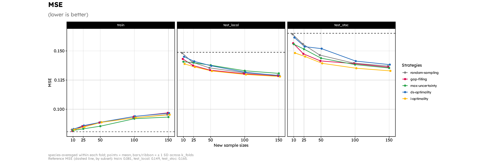{#fig-MSE_no_bars width=100%}

#### Delta MSE
```{bash}
#| echo: false
f=../outputs/results_analyses/Delta_MSE_distrib.pdf
dpi=300
# page size in pixels at the chosen dpi
read W H < <(pdfinfo "$f" | awk -v d=$dpi '/Page size/ {printf "%d %d", $3*d/72, $5*d/72}')

pdftoppm -png -r $dpi -singlefile \
  -x $(( W*0/100 )) -y $(( H*0/100 )) \
  -W $(( W*100/100 ))  -H $(( H*100/100 )) \
  "$f" ./images/Delta_MSE_distrib
```
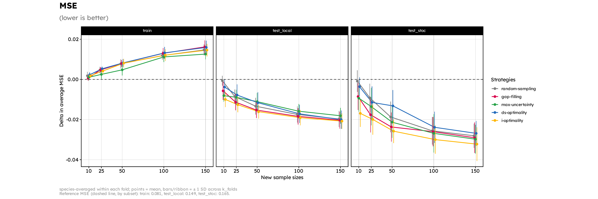{#fig-delta-mse width=100%}

#### SD of predictions
```{bash}
#| echo: false
f=../outputs/results_analyses/Delta_SD_distrib.pdf
dpi=300
# page size in pixels at the chosen dpi
read W H < <(pdfinfo "$f" | awk -v d=$dpi '/Page size/ {printf "%d %d", $3*d/72, $5*d/72}')

pdftoppm -png -r $dpi -singlefile \
  -x $(( W*0/100 )) -y $(( H*0/100 )) \
  -W $(( W*100/100 ))  -H $(( H*100/100 )) \
  "$f" ./images/Delta_SD_distrib
```
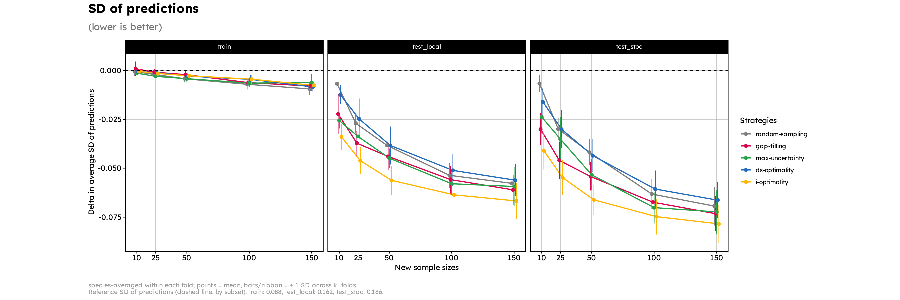{#fig-Delta_SD_distrib width=100%}
:::

Overall these results show that :

- **Results are better on training sets than on test sets.** This is expected as HMSC is fitted on specific values, and test datasets might contain environmental data conditions that the model never saw during fitting. But...
- **With more samples, MSE gets higher (worse) in training, but lower (better) on test datasets.** This might be counter-intuitive but is easily explained: more samples in training means more variations, which are difficult to predict. However this also helps to better estimate parameters, which make better prediction on never-seen-before environmental data. Nevertheless, training scores are best as they remain well under test scores[^10]. 
- **Gains in MSE can be substantial, even with a handful of new samples.** For I-optimality and with only 10 new samples, test scores on local sites show an improvement by 0.01 in MSE (-6.7% compared to base models), and by 0.017 in MSE (-10.3% compared to base models) on STOC data.
- SD of predictions decrease for all scores with the number of new samples added to the training dataset (although slower for training data than test, which is expected). 

[^10]: this is purely speculative but with many new samples, we should see the curves for training MSE and test MSE converge to a middle point, which should be around 0.11-0.12

### Mapping best locations
Data was simulated in 10 k-folds, all independent. By retrieving the sites that were chosen by each strategy for each fold, we can visualise ([@fig-freq-new-locations]) which new sites were more likely to be selected by each strategy.

```{bash}
#| echo: false
f=../outputs/results_analyses/freq-new-locations.pdf
dpi=300
# page size in pixels at the chosen dpi
read W H < <(pdfinfo "$f" | awk -v d=$dpi '/Page size/ {printf "%d %d", $3*d/72, $5*d/72}')

pdftoppm -png -r $dpi -singlefile \
  -x $(( W*30/100 )) -y $(( H*0/100 )) \
  -W $(( W*40/100 ))  -H $(( H*100/100 )) \
  "$f" ./images//freq-new-locations
```
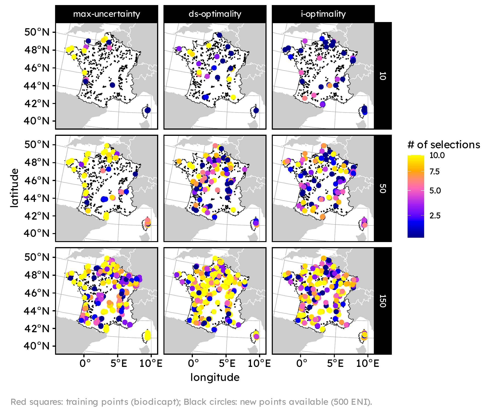{#fig-freq-new-locations width=100%}

These maps are loaded with details, here is a quick summary:

- **max-uncertainty** mostly selects sites that are on the edges of the country, often close to the sea. As BIODICAPT sites sit well inside the borders of France, it makes sense that where the model is the most uncertain of its predictions would be where there are no sampling sites in BIODICAPT.
- At first glance, **ds-optimality** and **i-optimality** seem to select points at random, but they actually optimise for specific parameters. Their maps tell us that some regions do not need to be sampled again (mainly, the south-mediterranean area) and that site choice is driven mainly by k-folds variability (aka: the distribution of species) (TODO: I should test that though).


## Inspiration and limits

This study was partly inspired by Mondain-Monval et al. (2024) [@mondainmonval_adaptive_2024]. The strategies "random-sampling", "gap-filling" and "max-uncertainty" are direct reproductions from their work. We modified several other aspects of their method (see [@tbl-methods-compared]) and added criterion-based strategies:

|   Method  | M.M. [@mondainmonval_adaptive_2024] | Ours |
|:---------:|:---------:|:---------:|
| Simulated dataset | Based on butterfly data | Based on STOC (FBBS) data |
| Number of species | 50 species | 40 species |
| Number of variables | 10 (randomly selected from 33 available) | 15 (hand picked, containing 2 actionable variables[^9]) |
| Model type | Ensemble model (GLM + GAM + RF) | HMSC |
| Re-training | Mixing of 1%, 10% or 50% of the initial dataset | Addition of new samples (50) to the initial dataset |
| Training size | 2000 cells | 150 locations + 50 new locations |

Table: Method described in this report compared with [@mondainmonval_adaptive_2024] {#tbl-methods-compared}


[^9]: for now, it is "light pollution" and "swf" as we consider that these are the only two variables that local politics can influence.

In their article, Mondain-Monval et al. (2024) [@mondainmonval_adaptive_2024] show interesting results:

![Copy of Figure 3 from Mondain-Monval et al. (2024) [@mondainmonval_adaptive_2024]](./images/figure3_mondain-monval_2024.png){#fig-figure3-MM width=80%}

These results can be compared to ours (see [@fig-delta-mse] and the following [@fig-delta-mse-n-sp]):
```{bash}
#| echo: false
f=../outputs/results_analyses/MSE_delta_n_sp.pdf
dpi=300
# page size in pixels at the chosen dpi
read W H < <(pdfinfo "$f" | awk -v d=$dpi '/Page size/ {printf "%d %d", $3*d/72, $5*d/72}')

pdftoppm -png -r $dpi -singlefile \
  -x $(( W*0/100 )) -y $(( H*0/100 )) \
  -W $(( W*100/100 ))  -H $(( H*100/100 )) \
  "$f" ./images/MSE_delta_n_sp
```
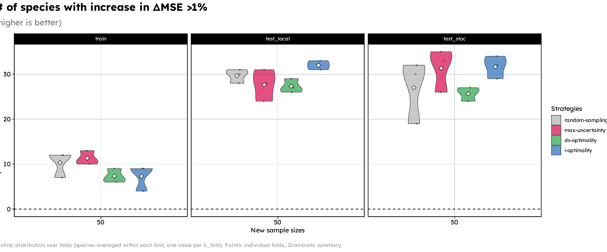{#fig-delta-mse-n-sp width=100%}

We assume that [@mondainmonval_adaptive_2024] show their results on a test set. Depending on the sampling strategy they use, most medians in their 50% mix yield to a gain of about 0.0015 in MSE. 

Our results for a 50% mix (150 BIODICAPT samples + 150 new samples) show mean improvements on a test set that are between 0.018-0.032 in MSE depending on strategy and type of test set (we use means for comparison here, as we used it in the rest of the report, but note that a comparison based on medians would actually *increase* these values in our favour).

There is a difference of a factor 21 between our measured improvements and [@mondainmonval_adaptive_2024]. This can almost entirely be attributed to our different re-sampling strategies: where [@mondainmonval_adaptive_2024] replaces old sampled locations to keep the same number of sampled sites, we are **adding** new sites. By construction, this gives more information to train our models, and make better predictions. In addition, the use HMSC (a jSDM model) might help to make better predictions, compared to SSDMs, thanks to the use of latent factors.

# Discussion

This work aimed at answering two questions:

1. Which points, in the 500 ENI network, are the most informative in order to improve the knowledge of species distribution studied within the BIODICAPT project, given previous data collection and current constraints?
2. Which points, in the 500ENI network, will allow to detect an effect of actionable variables on species distribution?

Ds-criterion and I-criterion (respectively) are *designed* to answer to these questions.

::: {.callout-note collapse="false"}
## To be continued...

This report is still under construction, come back later! 
:::