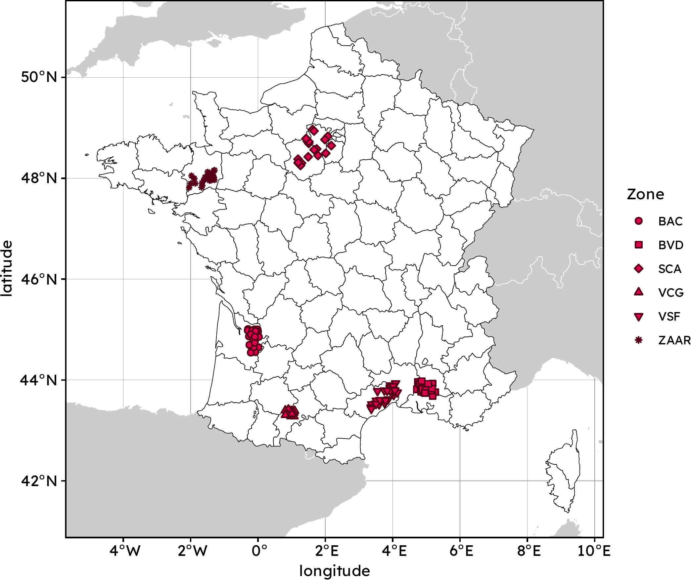
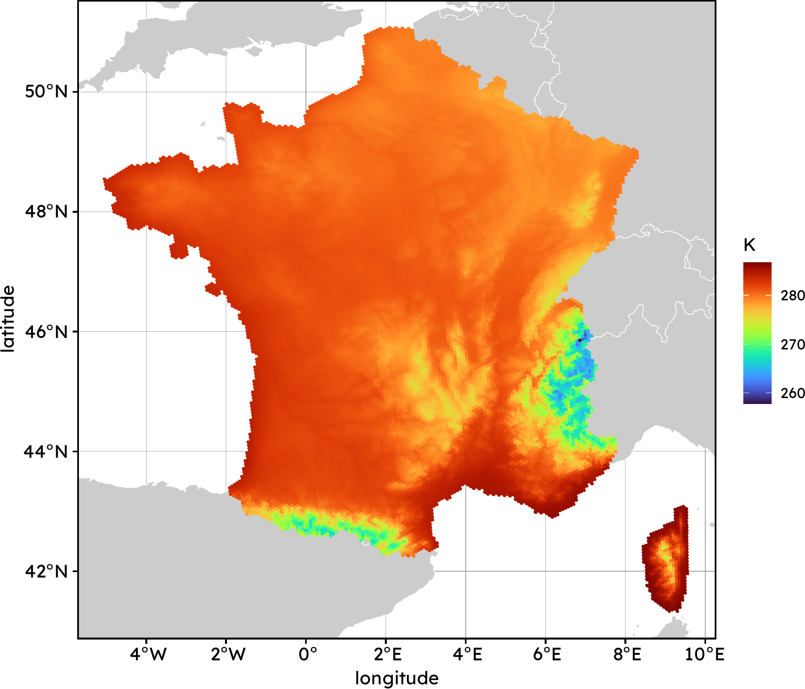
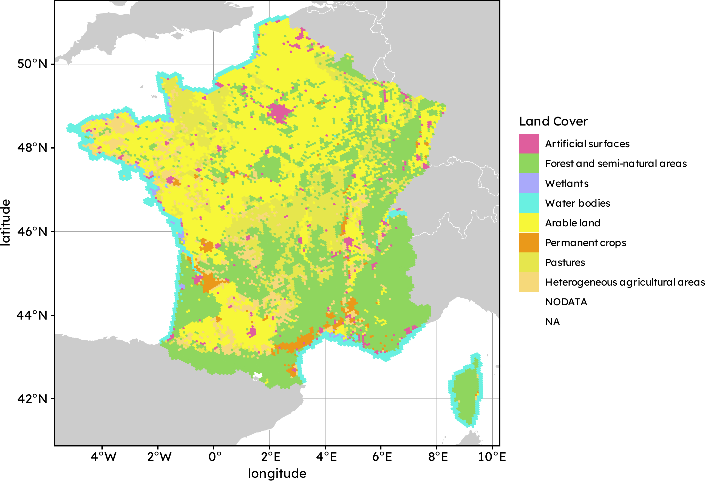
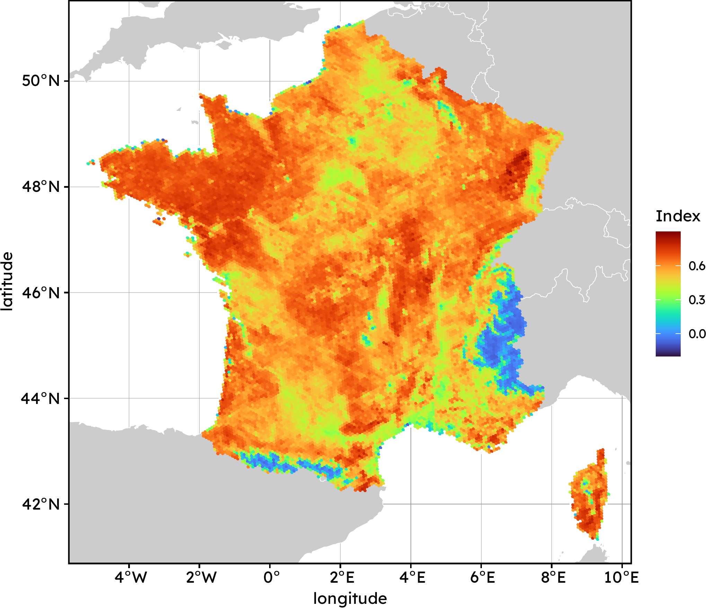
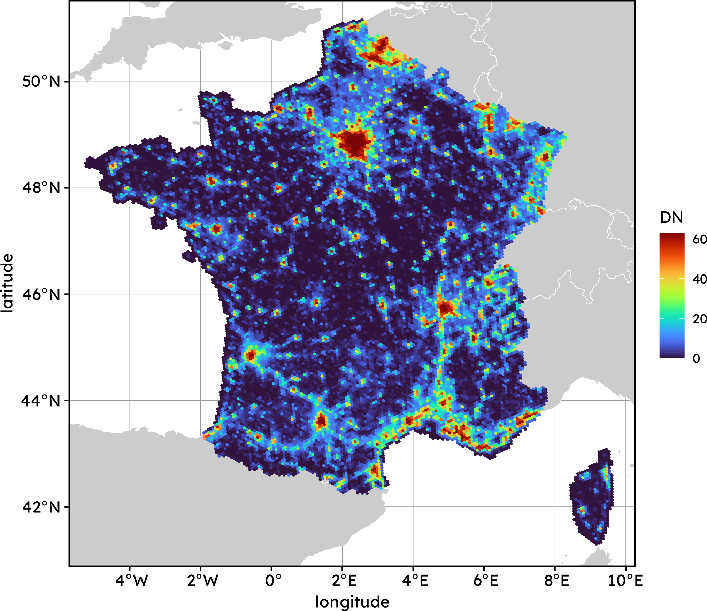

\thispagestyle{empty}
\newpage

# Introduction
## OED
**Optimal Experimental Design** (or OED for short) is a way for designing experiments that aims at maximising information gain while minimising a cost function. This cost function can encompass prediction uncertainty, material cost, deployment time... it is up to the user to select the parameters to optimise.

[The key concept is that **not all observations are equally informative**.]{.mark} 

This concept[^1] can be particularly interesting when working with participatory science datasets. The BIODICAPT research project, is aiming at working with voluntary participants but (due to time, logistical and budget constraint) cannot make use of all of them. In this context, pre-studying the sampling designs will allow to optimise data collection.

[^1]: Will sometimes be referred to as "adaptive sampling" in this report. 

## The BIODICAPT project

The "BIODICAPT"  project is a French research project that aims at monitoring biodiversity of agricultural lands on a large (*i.e. national*) scale through the use of various recording devices.

### The BIODICAPT network
The "BIODICAPT network" is a network of approximately 125 agricultural lands that are already in partnership with some of the research institutes and laboratories participating in the BIODICAPT project.

Consequently, these fields are quite clustered around the laboratories that collect data in them periodically. 

For the BIODICAPT project, additionnal data needs to be collected in order to better represent the varying agricultural contexts in France metropolitan area. In order to do this, the project aims at collecting data on a larger scale using the 500 ENI network.

{#fig-biodicapt width=75%}

### The 500 ENI network
The "500 ENI network" is a long-term survey that was initiated by the French Ministry of Agriculture in 2012. Its aim is to monitor any changes of wild flora and wild fauna in agricultural landscapes that could be associated with Non-Intended Effects (ENI) of agricultural practices, mainly the use of fertilisation and pesticides products.

It consists of approximately 500 fields distributed over all agricultural regions of France (including Corsica) that are sampled by voluntary observers. These field were originally chosen to be representative of the main crop productions of France's metropolitan area.

{#fig-eni500 width=75%}

### Constraints
The BIODICAPT project collects data on flora, using a protocol that is directly adapted from the one that has been in use in the 500 ENI network since 2012. Therefore there is no need re-sample wild flora in the 500 ENI network

In addition, the BIODICAPT project also aims at using passive acoustic monitoring to identify birds, pollinators, bats and micro-mammals automatically using Song Meters Mini Bat 2 and AI tools (which are not the subject of this study). 

With the available budget for the 500 ENI network, it is only possible to finance up to 50 acoustic recorders (+ accessories) for the BIODICAPT project in the 500 ENI network. Since this represents less than 10% of the whole 500 ENI network, the sampling design has to be thought of in advance. In addition, as acoustic data was not one of the initial protocols of the 500 ENI network, voluntary observers and farmers have to be motivated and give their consent in order to perform additional protocols on their lands. This means that new data collection for the BIODICAPT project is limited by budget and voluntary participation.

## Objectives
This work aims at answering two questions:

1. Which points, in the 500 ENI network, are the most informative in order to improve the knowledge of species distribution studied within the BIODICAPT project, given previous data collection and current constraints?
2. Which points, in the 500ENI network, will allow to detect an effect of actionable variables on species distribution?

# Material and Methods
## Dataset
The BIODICAPT project started in early-2026, with data collection (wild flora and passive acoustic monitoring) on agricultural plots at regular intervals between April and September. 

The first results on presence-absence of target species (inferred from acoustic recordings) are expected for late-2026 to early-2027. In the meantime, sampling designs for the 500 ENI network can be explored through publicly available data and simulations. 

The locations of the fields in the BIODICAPT network (~ 125 fields) and in the 500 ENI network (~ 500 fields) can be used to compute local environmental data and simulate realistic species distribution to find the best sampling designs for this project.

### Environmental data
Environmental data was extracted from several sources:

- [CHELSA-monthly](https://www.chelsa-climate.org/)
- [CORINE Land Cover](https://land.copernicus.eu/en/products/corine-land-cover/clc2018)
- Night time light data [@li_harmonization_2025]
- Elevation data [Elevatr r-package](https://github.com/usepa/elevatr)
- NDVI data [Earthdata (NASA website)](https://www.earthdata.nasa.gov/topics/land-surface/normalized-difference-vegetation-index-ndvi/data-access-tools)

Quantitative datasets were simply projected into the target raster grid while the qualitative dataset (CORINE Land Cover or CLC for short) was converted into two layers for each category inside it:

- One where each pixel contains the distance to the closest pixel of the category
- One where each pixel contains the proportion of pixels containing the category within a fixed range ($\sqrt{2 \times \text{res}^2}$)

Resolution ($res$) was chosen to be equal to 5 km, which is a good middle ground between local and global scale. Therefore, all rasters contains pixels of appoximately 5x5 km.

::: {.panel-tabset}
#### Temperatures
{#fig-chelsa_tas width=80%}

#### Land Cover
{#fig-CLC width=100%}

#### NDVI
{#fig-ndvi0 width=80%}

#### Light pollution
{#fig-light-poll width=80%}
:::

### Simulation of species distributions
Species distributions are simulated using the `virtualspecies` R-package [@virtualspecies].

This package takes a multi-layered raster as input (containing all environmental data layers stacked together) and selects a credible "ecological niche" within a PCA computed on the values of each pixel of this raster. This generates a "habitat suitability" index, from which a probability of occurence and ultimately presence-absence observations of the simulated species can be deduced. For more details please see the [tutorial for `virtualspecies`](https://borisleroy.com/virtualspecies_tutorial).

In order to approximate real species relative abundance, a sample of the STOC dataset [@valle_data_2026] was used as reference. It contains the real observations of 40 bird species over more than 7000 locations in France, in varying contexts. The presence rate of each species was used as a prevalence rate in the simulations.

{#fig-roc_stoc width=80%}

## Model
To model the distribution of simulated species over France's metropolitan area, we use a specific type of Species Distribution Models (SDM): Joint Species Distribution Models (JSDM). These models make use of several species distributions to find *latent* links between them, which supposedly improves the prediction accuracy[^2].

[^2]: JSDM are usually opposed to single SDMs (Species Distribution Models applied to one species) and SSDMs (Stacked SDMs: mutliple SDMs glued together, with no link between them).

### HMSC
For this work, HMSC (Hierarchical Modelling of Species Communities) is a good fit. It is a JSDM developped by Ovaskainen et al. (2017) [@ovaskainen_how_2017], and distributed as an open-source R-package on [GitHub](https://github.com/hmsc-r/HMSC/) [@tikhonov_joint_2020]. 

Due to its *relative* simplicity and ease of use, it is undoubtebly the most widely used JSDM in the last years. Its principle is summarised in the next figure, extracted from its original publication [@ovaskainen_how_2017]:

![Copy of Figure 4 from Ovaskainen et al. (2017) [@ovaskainen_how_2017]](images/figure4_ovaskainen_2017.png){#fig-HMSC width=100%}

### Other models
::: {.callout-caution collapse="true"}
## Work in progress...

Only HMSC has been implemented into our code for now. 

GJAM is under consideration, as well as other SDMs: RF, SSDM, deep-SDMs, ...

↳ This section will be updated when new results are available.
:::

## Adaptive sampling
Overall, the goal is to find the best 50 locations in the 500 ENI network to add to the BIODICAPT project in order to answer the questions of this study. 

In details, HMSC will first be fitted on the simulated presence observations of the 40 bird species at the BIODICAPT locations. Then, a new model will be fitted on the simulated presence observations in BIODICAPT and 50 locations of the 500 ENI network, chosen according to different strategies. Finally, metrics will be used to compare the "base" model to the "retrained" one, to see if there was any gain in quality of prediction and/or the estimation of the effect of actionable variables thanks to the addition of new samples from the 500 ENI network.

This process will be repeated 10 times, each time using a different set a 40 simulated species distributions (with prevalences based on the same STOC occurence reference), so that we can avoid any bias originating from the simulations.

Here is a visual summary :

{#fig-OED-BIODICAPT width=100%}

Now the question you should be asking yourself is "how do you choose which points should be added to the dataset that is used to train HMSC?".

We compared several strategies :

1. **Random sampling**: points are chosen at random in the 500 ENI network, which is a classical sampling design, but very naive.
2. **Gap-filling**: points are chosen to be a far as possible to the point that were sampled previously. By construction, this strategy adds points that are in a different geo-ecological context than the points sampled initial, which should broaden the range of environmental data and species observed.
3. **Max-uncertainty**[^3]: chooses the points for which the model is the most uncertain of its predictions (aka where the predictions are the most variable). This can either be done one time (for which points is the base model the most uncertain about?) or in several parts, because adding the most uncertain points is likely to change which points the model is the most uncertain about since we changed its training dataset. 

[^3]: max-uncertainty is often used in active learning methods, which is a connected field of study.

These strategies are directly inspired from a similar study [@mondainmonval_adaptive_2024], though we are using a jSDM model instead of an Ensemble of SSDMs, and that our "adaptive sampling" adds points, instead of changing the mix of sampled areas (which would be impractical in the real world, since )

However, "max-uncertainty" is only a proxy for prediction accuracy (and a heuristic), it is a good one but it does not directly answers the questions of this study. In addition, we also compute two **OED criteria**[^4], for a 4th strategy :

4. **Criteria-optimal**: chooses the points that maximises the information according to an optimality criteria.

[^4]: Wikipedia has a good introduction to these criteria, see [this page](https://en.wikipedia.org/wiki/Optimal_experimental_design#Minimizing_the_variance_of_estimators)

### Choosing the criteria
Which criteria should we use for this project? 

Well, in statistical jargon, the initial questions of this work become:

1. Which adaptive design minimises the model's uncertainty in its predictions?
2. Which adaptive design will enable to get the best estimate of the effect of our actionable variables?

Different goals give different criteria:

1. I-optimality, whose goal is to minimise the average prediction variance over the design space (aka our predictions).
2. Ds-optimality[^5], whose goal is to minimise the volume of the confidence ellipsoid for target parameters $\theta_1$ (aka the actionable variables), after accounting for the uncertainty induced by estimating "nuisance" parameters $\theta_2$ (aka the other, non-actionable, variables).

[^5]: FYI: D-optimality (not Ds-optimality) is the most widely used OED criteria. It is a special case of Ds-optimality which aims at maximising the determinant of the information matrix of the design to minimise the volume of the confidence elliposid for the entire set of parameters $\theta$. D-optimality results in maximising the differential Shannon information of the parameter estimates, which is very practical for Bayesian models.

However, since HMSC is a bayesian model with latent variables, these optimisation criterion, that are making use of the Fisher Information Matrix (FIM), are quite difficult (or sometimes, impossible) to actually compute within an acceptable time frame, even with a decent computing capacity. For this reason, acceptable approximations of these criterion are used in this study, relying on the comparison of the posterior distributions of the parameters fitted in the "base" model VS those in the "retrained" models.

### Setting and notation {#sec-notation}
A little of maths now. Buckle up, folks!

HMSC is essentially a linear model with random effects. In our study, co-occurence of species are integrated through random independent "site" errors. Therefore, each observation $y$ can be expressed:
$$
y = X\theta + \varepsilon \text{\qquad with } \varepsilon \sim \mathcal N(0, \sigma^2)
$$

Where $X \in \mathbb{R}^{n \times p}$ is the design matrix of the
covariates for the $n$ sites of the design and $p$ parameters, $\theta$ are the parameters and $\varepsilon$ the errors.

For this model, the Fisher Information Matrix $M$ is written (from [@atkinson_elemental_2014]):
$$
M = X^\top W X = \frac{1}{\sigma^2} X^\top X.
$$

The Fisher Information Matrix is a useful tool to measure the amount of information that $X$ carries about $\theta$. 

## Ds-optimality
### Formal definition
In some cases, we might be interested in splitting the parameters into those of "interest" $\theta_{1}$ of dimension $s$ and "nuisance" parameters $\theta_{2}$ (of dimension $p - s$). 

In this case, the information matrix $M$ can be partitioned (see [@yi_ds-optimal_2015] eq. 3.3):

$$
\begin{aligned}
M &= \begin{pmatrix} M_{11} & M_{12} \\ M_{21} & M_{22} \end{pmatrix}
\end{aligned}, \text{\quad with } X = [X_1 X_2] \text{ and } M_{12} = X_1^\top X_2
$$

By the block-inversion formula[^6], the covariance of $\theta_1$ when estimated together with $\theta_2$ is (see [@yi_ds-optimal_2015] eq. 3.8):

[^6]: Again, wikipedia explains this very well, see [this page](https://en.wikipedia.org/wiki/Block_matrix#Inversion).

$$
\operatorname{Cov}(\hat\theta_1) \;=\; (M^{-1})_{11} \;=\; \bigl(\underbrace{M_{11} - M_{12}\,M_{22}^{-1}\,M_{21}}_{M_{1|2}\;=\;\text{Schur complement}}\bigr)^{-1}.
$$

$M_{1|2}$ is the information about $\theta_1$ that remains after removing
what is confounded with the nuisance parameters $\theta_2$. 

If the columns of $X$ for $\theta_1$ and $\theta_2$ are orthogonal ($M_{12} = 0$), then $M_{1|2} = M_{11}$ and the nuisance parameters cost nothing. If they are strongly correlated, $M_{1|2}$ is much smaller than $M_{11}$.

To find the design that best estimates parameters, a popular criterion is the ${D}$-criterion $\Phi_{D}$ for $D$-optimal designs [@wald_efficient_1943; @kiefer_optimum_1959]. The design that best estimates parameters is a design that maximises:

$$
\Phi_{D} \;=\; \log\det M \;=\; -\log\det \bigl[M^{-1}\bigr]
$$

But in, reality, the ${D}$-criterion is a special case of the ${D_s}$-criterion, where $s = p$, which is written:

$$
\boxed{\;\Phi_{D_s} \;=\; \log\det M_{1|2} \;=\; -\log\det \bigl[M^{-1}\bigr]_{11}\;}
$$

Using $\det M = \det M_{22}\cdot\det M_{1|2}$, it can also be written (this form is actually the easiest to compute):

$$
\Phi_{D_s} \;=\; \log\det M \;-\; \log\det M_{22}
$$

::: {.callout-note collapse="true"}
## Special cases
- If $s = p$ Ds-optimality becomes the D-optimality.
- If $s = 1$: Ds-optimality becomes the C-optimality.
:::

### Adding a site
For each site added to the sampling design, the criterion can be computed again, and compared to the previous one. The design with the highest D-criterion being the closest to D-optimality. 

Let $M$ be the information of the current design and a candidate site $x$, with weight $w$ (independent observations), then the new information matrix $M'$ with the added site is derived directly from $M$ with:

$$
M' = M + w\, x x^\top .
$$

And we are interested in:

$$
\Delta\Phi_{D_s} = \Phi_{D_s}(M') - \Phi_{D_s}(M)
$$

The naive way of computing $\Delta\Phi_{D_s}$ would be to fit our model (HMSC) on a new point, computing $\Phi_{D_s}(M')$ and comparing it to the previous $\Phi_{D_s}(M)$. However, this would be computationally heavy for numerous new points and/or combinations of points, as HMSC is not exactly cheap to refit.

Another way is to use the Sherman–Morrison–Woodbury formula [@sherman_morrison_1950; @woodbury1950inverting], which enables to compute the inverse "rank-1 update" of a previous invertible matrix. This avoids having to compute new posteriors. 

::: {.callout-note collapse="true"}
#### Steps
This formula states that for a matrix $M'$ defined as above, then:

$$
M'^{-1} = M^{-1} - w \frac{M^{-1} x x^\top M^{-1}}{(1 + w x^\top M^{-1} x)}
$$

But to compute $\Delta\Phi_{D_s}$, we are only interested in $\det \bigl[M'^{-1}\bigr]_{11}$. Let's define $A = \bigl[M^{-1}\bigr]_{11}$ (so $A^{-1} = M_{1|2}$) and $a = [M^{-1}x]_{1:s}$, the first $s$ components of $M^{-1}x$. Then, with $c = \frac{w}{1 + w\,x^\top M^{-1}x}$ the expression becomes:

$$
M'^{-1} = A - w \frac{aa^\top}{(1 + w x^\top M^{-1} x)}
$$

And with $\gamma = \frac{w}{(1 + w x^\top M^{-1} x)}$ we can apply the matrix determinant lemma [^7] which gives:

$$
\begin{aligned}
\det\bigl([M'^{-1}]_{11}\bigr) &= \det(A - \gamma\,aa^\top)
  = \det(A)\,\bigl(1 - \gamma\,a^\top A^{-1}a\bigr)\\
  &= \det\bigl([M^{-1}]_{11}\bigr)\left(1 - \frac{w\,a^\top M_{1|2}\,a}{1 + w\,x^\top M^{-1}x}\right)
\end{aligned}
$$
$$
\begin{aligned}
    \Rightarrow \Delta\Phi_{D_s}
        &= -\log\det[M'^{-1}]_{11} + \log\det[M^{-1}]_{11}\\
        &= -\log\!\left(1 - \frac{w\,a^\top M_{1|2}\,a}{1 + w\,x^\top M^{-1}x}\right)
\end{aligned}
$$

[^7]: Hm, have you heard of wikipedia? see [here](https://en.wikipedia.org/wiki/Matrix_determinant_lemma).
:::

With it, the approximate gain (without using real full posteriors) in the Ds-criterion can be computed without refit using: 

$$
\boxed{\;\Delta\Phi_{D_s} \;=\; -\log\!\left(1 \;-\; \frac{w\; a^\top\, M_{1|2}\, a}{1 + w\, x^\top M^{-1} x}\right)\;}
$$

::: {.callout-important collapse="true"}
#### Limits
The formula assumes $w$ > 0, $M$ is invertible, and that a single candidate is added at a time.
:::

With this formula, a greedy selection (add the best candidate, update $M$, repeat) is relatively cheap to compute, HMSC never has to be refitted. However, it might not lead to the optimal design: the gain of a set of candidates is not
the sum of their individual gains (a candidate can be uninformative alone but valuable in combination), and greedy selection only looks one step ahead.

### Adding random effects {#sec-correlated}

The previous section assumed independent observations. With a spatially structured site-level random effect in HMSC, this no longer holds: nearby sites share information, and a new site close to the existing ones is partly redundant. This section extends the update formula to that case.

#### Setting
Let $V$ be the $n \times n$ covariance matrix of response variables. $V$ combines the covariance of the random effect (non-diagonal, since it depends on the distance between sites) and the independent residual variance (diagonal). For a Gaussian model with known $V$, the information matrix is

$$
M = X^\top V^{-1} X .
$$

If sites were independent, $V$ would be diagonal and we would recover $M = \sum_i w_i\, x_i x_i^\top$ with $w_i = 1/V_{ii}$, which is the previous section.

When adding a candidate, $M'$ becomes:

$$
X' = \begin{pmatrix} X \\ x^\top \end{pmatrix}, \qquad
V' = \begin{pmatrix} V & k \\ k^\top & v \end{pmatrix}, \qquad
M' = X'^\top V'^{-1} X' .
$$

With:

- $v$: the total variance of the responses at the candidate (random effect + residual),
- $k$: the $n \times 1$ vector of covariances between the candidate and the sites already in the design.

Inverting $V'$ by blocks gives:

$$
V'^{-1} =
\begin{pmatrix}
P + \dfrac{P k\, k^\top P}{\sigma_c^2} & -\dfrac{P k}{\sigma_c^2} \\[2mm]
-\dfrac{k^\top P}{\sigma_c^2} & \dfrac{1}{\sigma_c^2}
\end{pmatrix}.
$$

::: {.callout-tip collapse="true"}
#### Detailed inversion
By definition:
$$
\begin{aligned}
    V'V'^{-1} &= I\\
    \begin{pmatrix} V & k \\ k^\top & v \end{pmatrix} \begin{pmatrix} Q & b \\ b^\top & d \end{pmatrix} &= \begin{pmatrix} I_n & 0 \\ 0 & 1 \end{pmatrix}
\end{aligned}
$$

with $Q$ an $n \times n$ matrix, and b an $n \times 1$ matrix. Then, the system can be written as a system of 4 equations:

$$
\begin{aligned}
    \begin{cases}
        VQ + kb^\top = I\\
        Vb + kd = 0\\
        k^\top Q + v b^\top = 0\\
        k^\top b + v d = 1\\
    \end{cases}
\end{aligned}
$$

By solving for b using the 2nd equation, then solving for d using the last equation we get

$$
\begin{aligned}
    b = -Pkd &\text{, with } P = V^{-1}\\
    d = \frac{1}{\sigma_c^2} &\text{, with } \sigma_c^2 = v - k^\top P k\\
\end{aligned}
$$

Then, with $P = P^\top$:

$$
b = - \frac{Pk}{\sigma_c^2} \qquad \text{and} \qquad b^\top = - \frac{k^\top P}{\sigma_c^2}
$$

And finally, using equation 1 and $b^\top$:

$$
Q = P + \frac{Pkk^\top P}{\sigma_c^2}
$$
:::

In this matrix, $\sigma_c^2$ is the conventional notation for the conditional variance of the candidate given the existing sites (the Schur complement of $V$ in $V'$):

$$
\sigma_c^2 = v - k^\top P\, k ,
$$

::: {.callout-note collapse="true"}
#### FYI
$k^\top P k$ is the part of the candidate's variance that is predictable from the existing sites, so $\sigma_c^2$ is the variance that is genuinely new.
:::

Then, $M'$ is simply obtained by multiplying out $X'^\top V'^{-1} X'$:

$$
M' = \underbrace{X^\top P X}_{M} + \frac{(x-u)(x-u)^\top}{\sigma_c^2} \text{, with } u = X^\top P k
$$

::: {.callout-note collapse="true"}
#### FYI
$X^\top P k$ is the part of the candidate's covariates that can be predicted from the existing sites through the spatial correlation, so $x - u$ is what remains.
:::

Which we note

$$
\boxed{\; M' = M + \frac{r\, r^\top}{\sigma_c^2} \;} \qquad \text{with } r = x - X^\top P\, k
$$

#### Delta Ds-criterion
We recognise the expression $M' = M + w\,xx^\top$ that we computed previously, with:

$$
x \;\to\; r, \qquad w \;\to\; \frac{1}{\sigma_c^2}.
$$

Therefore, replacing in the previous expression of $\Delta\Phi_{D_s}$ that we obtained, we get:

$$
\boxed{\;\Delta\Phi_{D_s} = -\log\!\left(1 - \frac{a^\top M_{1|2}\, a}{q}\right)\;}
$$

With $a = [M^{-1}x]_{1:s}$ and $q = \sigma_c^2 + r^\top M^{-1} r$, substituting $w = 1/\sigma_c^2$ and $x = r$ in the previous boxed formula and multiplying numerator and denominator by $\sigma_c^2$.

#### Interpretation

- **Far from the design** ($k \approx 0$): $r \approx x$ and $\sigma_c^2 \approx v$, so we recover the independent case with $w = 1/v$.
- **Close to the design** (strong correlation): the candidate's covariates are well predicted by its neighbours, so $r \to 0$ while $\sigma_c^2$ stays bounded below by the residual variance. Hence $rr^\top/\sigma_c^2 \to 0$ and so does the gain. If $x$ differs from its neighbours, $r$ stays large and the candidate remains informative.

Spatial spreading of the design therefore emerges naturally from the criterion, without being imposed. This strategy can be compared with gap-filling to assess its actual advantages.

::: {.callout-important collapse="true"}
## Assumptions and limits
- $V$ is treated as known. In practice it is built from posterior estimates of the random-effect parameters (variance and spatial range) and the residual variance, so the gain is conditional on those estimates.
- The site random-effect is unstructured (one independent level per site), therefore $V$ is diagonal, $k = 0$, and the previous section applies directly with $w = 1/v$.
- As before, a single candidate is added at a time, and $M$ must be invertible.
:::

### Application to HMSC

HMSC is a Bayesian model. More specifically, in our case: a probit model with random site effects. For site $i$, species $j$, random level $l$, and $h$ the latent factor within that level, the latent variable $z_{ij}$ is written:

$$
\begin{aligned}
    z_{ij} = x_i^\top \beta_j + \sum_{l}\sum_h \lambda_{lhj}\,\eta_{lhi} + \varepsilon_{ij},
    \\
    \text{with } y_{ij} &= 1 (z_{ij} > 0)\\
    \varepsilon_{ij} &\sim\mathcal N(0,1)\\
    \operatorname{Cov}(\eta_{lh\cdot}) &= K_{lh}\\
    \beta_j &= (\underbrace{\beta_{S,j}}_{\theta_1},\; \underbrace{\beta_{N,j}}_{\theta_2})
\end{aligned}
$$

With:

- $S$ the set of covariates we want to estimate precisely (e.g. the actionable variables) and $N$ the intercept and the other covariates.
- $\eta_{lhi}$ is the score of the factor ($l$, $h$ at site $i$). It is a latent variable, not observed. $\eta$ is correlated across units with $K_{lh}$ (see details under).
- $\lambda_{lhj}$ is the loading on factor ($l$, $h$, for species $j$). It says how strongly, and in which direction, the species responds to that latent gradient. 
- $\varepsilon_{ij}$ is the residual error in the probit model. 

The matrix $K_{lh}$ depends on the type of random level:

- spatial level: $K_{lh} = \exp(-d/\alpha_{lh})$ (correlation decaying with $d$, the matrix of pairwise distances between units);
- site (unit) level, non-spatial: $K_{lh} = I$ (independent units).

**There is no closed-form information matrix**, for two reasons: the outcome is
binary (it is a non-linear model, so information depends on $\beta$), and
the random effects must be integrated. 

One remedy [@breslow_approximate_1993; @mentre_optimal_1997; @waite_designs_2015] is to approximate the information matrix of the GLMM by linearising the model around a plug-in value of the parameters (here the posterior mean of the "initial" BIODICAPT model), which yields to a Gaussian working model with covariance $W_j^{-1} + G_j$. We use this solution, though it is the first time (to the best of our knowledge) that it is applied on a probit model with latent factors.

$$
M_j \;\approx\; X^\top\bigl(W_j^{-1} + G_j\bigr)^{-1}X,
\qquad
G_j = \sum_{l,h} \mathbb{E}(\lambda_{lhj}^2)\ K_{lh},
$$

Where

- $W_j = \operatorname{diag}\!\bigl(w_{ij}\bigr)$ with $w_{ij} = \dfrac{\varphi(\eta_{ij})^2}{\Phi(\eta_{ij})\bigl(1-\Phi(\eta_{ij})\bigr)}$ and
  $\eta_{ij} = x_i^\top \hat\beta_j$
- $G_j$ is the covariance of the random-effect contribution to the linear predictor, averaged over posterior draws.

::: {.callout-important collapse="true"}
## Limits
- This formula assumes one unit is one site, there cannot be repetitions.
- $\eta_{lhi}$ must be independent across $(l, h)$ and independent of $\varepsilon$, which is true in our parametrisation of HMSC.
- As stated above, the computation of $M_j$ is an approximation. $W_j$ is evaluated at the value of $\beta_j$ given by a prior guess (the initial model).
- In practice, we will evaluate $\sum_{j} \Delta\Phi_{D_s}$ to summarise each design, this metric ignores cross-species dependence shared through $\eta$.
:::

::: {.callout-tip collapse="true"}
## How to compute it
For a species $j$, a candidate site $c$ and the $n$ design sites, we need:
- $X$: the covariates (`hM$X`)
- $\hat\beta_j$: posterior mean coefficients (`getPostEstimate(m, "Beta")$mean[, j]`)
- $w_{i,j}$ or $w_c$: probit weights at $\eta = x^\top \hat\beta_j$ (`dnorm`, `pnorm`)
- $\lambda_{lhj}$: the loadings (`post[[t]]$Lambda[[r]][h, j]`)

Then it is just a matter of a adding and multiplying these quantities correctly. Be sure to use the same scaling for the candidate that was used to fit $\beta$. Compute $\Delta\Phi_{D_s}$ for each species and sum it/average it to rank candidates.
:::

### Evaluation of design

Once a model has been refitted on BIODICAPT + the new sites using Ds-optimality, the realised analogue of the criterion is available from the MCMC draws:

$$
\widehat{\Phi}_{D_s} \;=\; -\log\det \widehat{\operatorname{Cov}}_{\text{post}}\!\bigl(\beta_{S,j}\bigr),
$$

Under an approximately Gaussian posterior, it is the same quantity as $\log\det M_{1|2}$ (plus the prior).

**Bonus**: To understand this criterion, a minimal working example comparing random, gap-filling, max-uncertainty, Ds- and I-optimal designs is available in [an accompanying quarto document](./minimal_working_examples/I-optimality.qmd).

<!-- ## I-optimality
### Formal definition
While Ds-optimality is about estimating *parameters*, when the goal is to *predict* well, what matters is the uncertainty of the predictions $\hat y(x_0)$ at the sites $x_0$ where the model will be used. In this case, statisticians use I-optimality (for *Integrated*-optimality). It minimises the average prediction variance over a region of interest $\mathcal{T}$, for example a sample of pixels of France or the test sites.

For a linear model, the variance of the prediction at $x_0$ is $\operatorname{Var}(x_0^\top\hat\theta) = x_0^\top M^{-1} x_0$. Averaging over $T$ sites (a subset of $\mathcal{T}$) gives:

$$
\frac{1}{T}\sum_{t=1}^{T} x_t^\top M^{-1} x_t \;=\; \operatorname{tr}\!\bigl(M^{-1} B\bigr),
\qquad
B = \frac{1}{T}\sum_{t=1}^{T} x_t x_t^\top ,
$$

We call $B$ the "moment matrix" of the region. 

With the same sign convention as for Ds-optimality (where we are looking to maximise the criterion), then:

$$
\boxed{\;\Phi_{I}(D) \;=\; -\operatorname{tr}\!\bigl(M(D)^{-1} B\bigr)\;}
$$

::: {.callout-note}
## Non-linear (probit) models
What we predict is a probability $p_t = \Phi(x_t^\top\beta)$, not the linear predictor. By the delta method, $\operatorname{Var}(\hat p_t) \approx \varphi(\eta_t)^2\, x_t^\top M^{-1} x_t$ (with $\eta_t = x_t^\top\beta$). The same formula holds with a weighted moment matrix:

$$
B = \frac{1}{T}\sum_{t=1}^{T} \varphi(\eta_t)^2\, x_t x_t^\top .
$$

so that $\operatorname{tr}(M^{-1}B)$ is exactly the average variance of the predicted probabilities. The weights $\varphi(\eta)^2$ give less importance to sites where the probability is close to 0 or 1 (where it hardly moves when $\beta$ changes).
:::

### Link with the previous criteria

- **D- vs I-optimality**: Ds-optimality looks at the *volume* of the confidence ellipsoid of some parameters, I-optimality looks at the *trace* of $M^{-1}$ weighted by where we predict. A design that is good for one can be bad for the other: for inference, Ds-optimal designs put sites at the extremes of the gradient of interest, which may leave other directions of the parameter space poorly determined, and predictions rely on all of them.
- **Max-uncertainty vs I-optimality**: max-uncertainty ranks candidates by $\varphi(\eta_c)\sqrt{x_c^\top M^{-1}x_c}$, which is the prediction variance at the candidate *itself*. This essentially is the I-criterion in the special case where the region of interest is reduced to one candidate, $B = x_c x_c^\top$. It is a good proxy but it ignores that two similar uncertain candidates are redundant, whereas I-optimality accounts for it (the gain of a site decreases once similar sites are added).

### Adding a site
With $M'$, $M^{-1}$, $a$ and $q$ defined as they were for Ds-optimality, then we get:

$$
\boxed{\;\Delta\Phi_{I}(x) \;=\; \operatorname{tr}(M^{-1}B) - \operatorname{tr}(M'^{-1}B) \;=\; \frac{a^\top B\, a}{q}\;}
$$

Where $q = \frac{1}{w} + x^\top M^{-1} x$

Compared with $\Delta\Phi_{D_s} = -\log\bigl(1 - a_S^\top S\, a_S / q\bigr)$, only the numerator differs. All candidates can therefore be scored at once with matrix products, the best one is added, $M$ is updated, and the process is repeated (greedy selection, no model refit). With correlated observations (@sec-correlated), the same formula holds with $x \to r$ and $w \to 1/\sigma_c^2$.

### Application to HMSC
The recipe is the one of the Ds-optimality section, applied to each species $j$ and then summed:

1. **Current information** $M_{0,j}$: the *posterior precision* of $\beta_j$ in the model fitted on the current design, $M_{0,j} = \widehat{\operatorname{Cov}}_{\text{post}}(\beta_j)^{-1}$, computed from the MCMC draws. It contains the information of the current sites (and of the prior), whatever the random effects.
2. **Weights** $w_{ij}$ of the candidates: the probit weights at the posterior mean $\hat\beta_j$ (not at unknown true values), attenuated by the non-spatial random effects with the Laplace-type approximation above, $w_{ij} \leftarrow \bigl(1/w_{ij} + g_j\bigr)^{-1}$, $g_j = \sum_h \lambda_{hj}^2$ averaged over posterior draws. For a "site" random level ($K = I$) this is all that is needed, because $G_j = g_j I$ keeps observations independent.
3. **Region of interest** $B_j$: computed at $\hat\beta_j$ with the sites in `target_set` (by default, the pool of candidates is used as a proxy of the region we want to predict).
4. **Greedy selection**: at each step, the gains $\Delta\Phi_{I,j}(x)$ of all remaining candidates are computed for each species, summed over species with equal weights (which gives the average prediction variance over species, the quantity that is also measured at the end through the SD of predictions), the best candidate is added, and all the $M_j$ are updated. For several `n`-part strategies, the model is refitted between the parts, so that $M_{0,j}$ and $\hat\beta_j$ are updated.

::: {.callout-warning}
## Approximations
- Species are treated as independent: the information shared between species through the latent factors is ignored.
- The prediction variance only counts the uncertainty on $\beta$, not the uncertainty on the random effects at the predicted sites.
- Spatial random levels are not implemented (they require the covariance between sites, see @sec-correlated); the code stops with an error in that case.
:::

### Evaluation of design
Once a model has been refitted on BIODICAPT + the new sites from the 500 ENI network using I-optimality, the realised analogue of the criterion is the average posterior standard deviation of the predictions on independent sites (the "SD of predictions" metric in the results), which can be compared to the one of the reference model. We also look at the error of the predictions (MSE).

**Bonus**: To understand this criterion, a minimal working example comparing random, gap-filling, max-uncertainty, Ds- and I-optimal designs is available in [an accompagning quarto document](./minimal_working_examples/I-optimality.qmd). -->

# Results
Models are evaluated using several metrics:

- MSE of predictions: measures the deviation between observations and predictions.
- SD of predictions: measures the "spread" of predictions posteriors.
- SD of parameters: measures the "spread" of parameters posteriors.

The goal is to find the strategy that minimises these metrics the most.

::: {.callout-note collapse="false"}
## To be continued...

This report is still under construction, come back later! 
:::